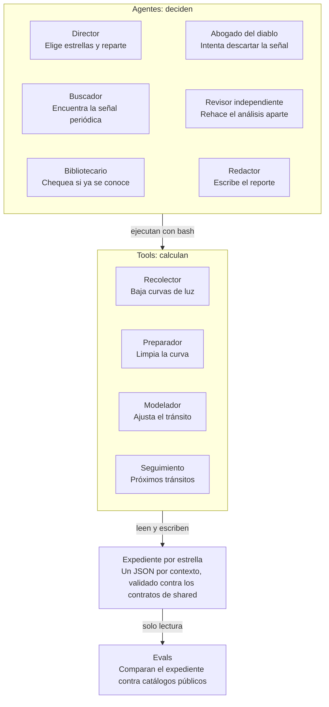

# Astronomy Hub: spec v0.1

Nov 26, 2026 · @JERO

## Objetivo y alcance

La v0.1 es un hub open source de agentes que busca tránsitos de exoplanetas en datos públicos de TESS y entrega, por cada estrella, un expediente verificable con veredicto y reporte.

**Entra en la v0.1**

- Una sola misión: exoplanetas por tránsito en curvas de luz de TESS.
- Seis agentes y diez contextos sobre Claude Managed Agents.
- Evals automáticos contra catálogos públicos, corridos por versión de agente.
- Todo por línea de comandos.

**Queda afuera**

- Otras misiones (estrellas variables, transitorios, agujeros negros, anomalías). El diseño deja el lugar, no el código.
- Confirmar planetas. El hub produce candidatos; la confirmación requiere seguimiento con telescopios.
- Barridos masivos. La v0.1 corre de a una estrella o en lotes chicos.
- Interfaz gráfica y envío automático de candidatos a canales oficiales.

**Se considera terminada cuando**

1. `make hello` corre los seis agentes de punta a punta sobre WASP-18 b y recupera su período (cerca de 0,94 días) con error menor al 1%.
2. `make eval-dev` corre el set de evals y publica la tabla de métricas con la versión de cada agente.
3. Los umbrales de la sección Evals se cumplen en el set reservado.
4. No hay secretos en el repo y toda sesión corre con presupuesto.

## Decisiones tomadas

Estas decisiones están cerradas para la v0.1; lo que sigue abierto está en Riesgos y preguntas abiertas.

| Tema | Decisión | Por qué |
| --- | --- | --- |
| Plataforma | Claude Managed Agents (beta), detrás de un adaptador `runtime/` | Sandbox, sesiones y multiagente ya resueltos; el adaptador permite correr en local más adelante |
| Agentes o tools | 6 agentes y 4 contextos que solo exponen tools | Agente donde hay criterio o hace falta contexto aislado; tool donde hay cálculo determinista |
| Qué es una tool | Un comando CLI del repo que el agente ejecuta con bash | Tiene que correr en el sandbox, junto a los datos. Las *custom tools* de la plataforma corren en la app cliente |
| Lenguaje | Python 3.12 en todo el repo | El ecosistema de astronomía es Python; un solo toolchain |
| Arquitectura | DDD y hexagonal por bounded context, repositories, casos de uso con un único `execute()` | Convención habitual del autor |
| Misión inicial | Exoplanetas por tránsito con TESS | Datos públicos y limpios, respuestas conocidas en catálogos, referencias open source |
| Comunicación entre contextos | Expediente en disco con contratos JSON | Los agentes comparten disco pero no contexto; los evals leen los mismos archivos |
| Modelos | `claude-opus-5-5` para Director, Abogado del diablo y Revisor; `claude-sonnet-5-5` para el resto | El criterio más fino va al modelo más capaz; se cambia en cada `agent.md` |
| Gasto | Presupuesto duro por sesión desde el primer día | Es un proyecto de prueba; el tope evita sorpresas |

## Arquitectura por contextos

Cada rol de astrónomo es un bounded context con la misma forma interna; seis tienen agente y cuatro solo exponen tools.



Los agentes ejecutan las tools con bash, las tools dejan su resultado en el expediente y los evals solo lo leen.

| Contexto | Rol | Tipo | Escribe en el expediente |
| --- | --- | --- | --- |
| `direction` | Director | Agente líder | `plan.json`, `decision.json` |
| `acquisition` | Recolector | Tools | `lightcurve/`, `star.json` |
| `preparation` | Preparador | Tools | `lightcurve_clean.parquet` |
| `detection` | Buscador | Agente | `search.json`, `signal.json`, `folds/` |
| `modeling` | Modelador | Tools | `model.json` |
| `catalog` | Bibliotecario | Agente | `catalog.json` |
| `vetting` | Abogado del diablo | Agente | `vetting.json` |
| `review` | Revisor independiente | Agente | `review.json` |
| `followup` | Seguimiento | Tools | `ephemeris.json` |
| `reporting` | Redactor | Agente | `report.md` |

El orden de trabajo es Director, Buscador, Bibliotecario, Abogado del diablo, Revisor y Redactor. El Director corta antes si no hay señal o si el objeto ya está catalogado.

**Estructura del repo**

```
astronomy-hub/
├── contexts/
│   ├── direction/      # Director (agente líder)
│   ├── acquisition/    # Recolector (tools)
│   ├── preparation/    # Preparador (tools)
│   ├── detection/      # Buscador (agente)
│   ├── modeling/       # Modelador (tools)
│   ├── catalog/        # Bibliotecario (agente)
│   ├── vetting/        # Abogado del diablo (agente)
│   ├── review/         # Revisor independiente (agente)
│   ├── followup/       # Seguimiento (tools)
│   └── reporting/      # Redactor (agente)
├── shared/
│   ├── kernel/         # StarId, LightCurve, Period: value objects comunes
│   ├── contracts/      # modelos pydantic de cada JSON del expediente
│   └── prompts/        # reglas comunes a todos los agentes
├── missions/
│   └── exoplanets/     # mission.yaml: objetivos, umbrales, set de evals
├── evals/              # build_set, runner, scorer; solo leen el expediente
├── runtime/            # adaptador a Managed Agents
├── tests/              # tests de shared y de arquitectura
├── docs/               # este spec
├── .claude/skills/     # un SKILL.md por contexto
├── environment.yaml    # sandbox: paquetes y hosts permitidos
├── claude-lock.json    # IDs generados por ant apply (se commitea)
├── Makefile
└── .env                # fuera de git
```

**Forma de cada contexto**

```
contexts/vetting/
├── domain/             # Gate, GateResult, Verdict: puro, sin I/O
├── application/        # un caso de uso por archivo, con execute()
├── infrastructure/     # repositories y adaptadores (disco, catálogos)
├── cli.py              # expone cada caso de uso como tool
├── agent.md            # solo si el contexto tiene agente
└── tests/
```

**Reglas**

1. Un contexto no importa a otro. Solo depende de `shared/`, y un test de arquitectura lo verifica en CI.
2. `domain/` no hace I/O. `application/` orquesta puertos. `infrastructure/` los implementa.
3. Los contextos se comunican únicamente por el expediente.
4. Las tools son deterministas: misma entrada, misma salida, y se testean sin LLM ni red.
5. `runtime/` es el único lugar que conoce Managed Agents, y el único que importa `anthropic`.
6. Lo específico de la misión entra por `mission.yaml`, nunca hardcodeado en un contexto.
7. `evals/` no importa ningún contexto: solo lee el expediente con los contratos de `shared/`.

Las reglas de imports (1, 2, 5 y 7, más las capas `cli → infrastructure → application → domain` de cada contexto y que `shared/` no importe `contexts/`) las verifica import-linter. Un test sobre el AST falla si algún `domain/` importa módulos de I/O o llama a `open`, `input` o `print`.

## Expediente y contratos

El expediente es una carpeta por estrella donde cada contexto deja un archivo con formato fijo; es el único canal entre agentes y lo único que leen los evals.

```
workspace/exoplanets/<tic_id>/
├── plan.json                  # direction
├── lightcurve/                # acquisition: FITS crudos por sector, sNNNN.parquet y manifest.json
├── star.json                  # acquisition: parámetros de la estrella y vecinos
├── lightcurve_clean.parquet   # preparation
├── search.json                # detection: picos de BLS y armónicos descartados
├── signal.json                # detection
├── folds/                     # detection: datos y resumen de cada curva plegada
├── model.json                 # modeling
├── catalog.json               # catalog
├── vetting.json               # vetting
├── review.json                # review
├── ephemeris.json             # followup
├── decision.json              # direction
├── report.md                  # reporting
├── figures/                   # PNG de curvas plegadas y pruebas
├── log.jsonl                  # una línea por tool ejecutada
└── .cache/                    # cachés de astropy, astroquery y matplotlib de esta estrella
```

Todos los JSON comparten un sobre: `schema_version`, `tic_id`, `mission`, `produced_by` (contexto, tool, versión), `created_at`, `inputs` (hash de cada archivo leído) y `data`.

**Sobre**

| Campo | Forma |
| --- | --- |
| `schema_version` | Semver, por ejemplo `"0.1.0"` |
| `tic_id` | Entero positivo |
| `mission` | String (slug, por ejemplo `exoplanets`) |
| `produced_by` | `{context, tool, version}`; `context` es uno de los diez contextos |
| `created_at` | Fecha y hora siempre en UTC; se rechaza cualquier otra zona horaria |
| `inputs` | `{ruta_relativa: "sha256:<hex>"}` por cada archivo leído |
| `data` | El contenido propio de cada archivo, según la tabla de abajo |

Todos los modelos son inmutables y rechazan campos desconocidos (`extra="forbid"`). No se aceptan `NaN` ni infinitos.

| Archivo | Campos principales de `data` |
| --- | --- |
| `signal.json` | `detected`, `period_days`, `epoch_btjd`, `duration_hours`, `depth_ppm`, `snr`, `n_transits`, `sectors`, `method`, `other_peaks` |
| `model.json` | `rp_rs`, `planet_radius_rearth`, `impact_parameter`, `a_rs` como `Measurement`, `stellar_source` |
| `star.json` | `ra_deg`, `dec_deg`, `tmag`, `teff_k`, `logg`, `radius_rsun`, `mass_msun`, `contamination_ratio`, `source`, `neighbor_radius_arcsec`, `neighbors` |
| `lightcurve/manifest.json` | `flux_column`, `available_sectors`, `selection_rule`, `sectors` (archivo FITS, tabla extraída, cadencias, puntos válidos, inicio y fin) |
| `search.json` | `method`, `sectors`, `period_min_days`, `period_max_days`, `peaks` (id, período, época, duración, profundidad, SNR, tránsitos), `discarded` (pico, motivo, `harmonic_of`, `ratio`) |
| `folds/<tag>.json` | Período, época y duración usados, profundidad por bin, pares contra impares, dispersión fuera de tránsito |
| `catalog.json` | `status` (`known_planet`, `toi`, `ctoi`, `known_false_positive`, `eclipsing_binary`, `unknown`), `matches` (catálogo, id, período, disposición, URL), `literature` |
| `vetting.json` | `gates` (`id`, `status`, `severity`, `value`, `threshold`, `note`), `verdict` (`candidate`, `false_positive`, `inconclusive`), `rationale` |
| `review.json` | `period_days_independent`, `depth_ppm_independent`, `disagreements`, `verdict` (`reproduced`, `partial`, `not_reproduced`) |
| `decision.json` | `final` (`no_signal`, `known`, `false_positive`, `candidate`, `inconclusive`), `reason`, `next_step` |

**Detalle de los contratos**

- `signal.json`: `period_days`, `epoch_btjd`, `duration_hours`, `depth_ppm`, `snr` y `n_transits` son opcionales en el tipo, pero un validador los exige con `detected=true` y los exige en `null` con `detected=false`. `sectors` (al menos uno), `method` y `other_peaks` van siempre. Cada elemento de `other_peaks` es `{period_days, snr, depth_ppm}`.
- `model.json`: cada parámetro es un `Measurement {value, err_lower, err_upper}`. Los errores son magnitudes no negativas: el intervalo es `[value - err_lower, value + err_upper]`.
- `catalog.json`: cada elemento de `literature` es `{title, url, note}`. `disposition` en `matches` es un string libre hasta confirmar los valores de ExoFOP.
- `vetting.json`: cada gate tiene `id` como slug (no número), `status` (`pass`, `fail`, `marginal`), `severity` (`hard`, `soft`), y `value` y `threshold` como `float | None`. Qué gates son `hard` se define en M2.
- `model.json`: `planet_radius_rearth` y `stellar_source` son opcionales y van juntos. Si `star.json` no trae el radio estelar con su error, el ajuste termina bien, ambos quedan en `null` y la tool lo avisa en el resumen. Si lo trae, el error del radio estelar se propaga al del planeta.
- `star.json`: cada parámetro estelar es un `Measurement` y solo se registra si el TIC trae el valor con su error; si no, queda en `null`. Los vecinos son `{tic_id, separation_arcsec, tmag}`, ordenados por separación.
- `search.json`: los picos con profundidad no positiva y los armónicos de un pico mejor rankeado no entran en `peaks`, pero quedan en `discarded` con su motivo (`non_positive_depth` o `harmonic`) y, si es armónico, con el id del pico que se quedó y la razón entre períodos (por ejemplo `"2/1"`).
- Un pico es armónico de otro mejor rankeado si la razón entre sus períodos coincide, dentro de `harmonic_tolerance`, con un múltiplo o submúltiplo entero cualquiera, o con una fracción n/m con n, m ≤ `harmonic_max_integer`.
- `folds/<tag>.json`: la profundidad en tránsito y la de tránsitos pares e impares se miden tránsito por tránsito; su error sale de la dispersión entre tránsitos y no de la dispersión punto a punto, para que una diferencia sistemática entre sectores no parezca significativa. `n_odd` y `n_even` cuentan tránsitos.
- El SNR de un pico es `depth / depth_err` del BLS de astropy: es un SNR de ruido blanco. En M2 hay que verificar que coincida con la definición de la prueba 3 del repo de referencia.
- `review.json`: `verdict` tiene su propio enum, distinto del de vetting, y reemplaza al booleano `reproduced`. Con `reproduced`, `period_days_independent` y `depth_ppm_independent` son obligatorios; en los otros casos pueden ir en `null`. `disagreements` es una lista de strings.

**Regla del Director para `decision.json`**

Cuando el caso llega a Vetting y Review, `final` sale de esta regla y no de un promedio de opiniones:

- `candidate` solo si `vetting.verdict = candidate` y `review.verdict = reproduced`.
- `false_positive` si `vetting.verdict = false_positive`.
- `inconclusive` en cualquier otro caso.

Los cortes anteriores (`no_signal` después de Detection, `known` o `false_positive` después de Catalog) siguen como están en el prompt del Director.

- Los contratos viven en `shared/contracts/` como modelos pydantic. Cada tool valida al escribir y los evals validan al leer.
- Un agente nunca edita a mano el JSON de otro contexto.
- `log.jsonl` registra comando, versión, duración y hash de salida, para poder reproducir cualquier expediente. Cada línea es un `LogEntry`: `ts`, `context`, `tool`, `argv`, `version`, `duration_s`, `exit_code`, `outputs` (ruta y hash), `summary` (el mismo resumen que va a stdout), `reason` (opcional, por ejemplo el `--reason` de `select-peak`) y `error`.
- `produced_by.version` es `0.1.0+g<sha corto>`, con el sufijo `.dirty` si el árbol tiene cambios sin commitear, o `0.1.0` si no hay git. El hash de salida de un JSON se calcula sobre `data` serializado en forma canónica, no sobre el sobre: dos corridas iguales dan el mismo hash aunque cambie `created_at`.
- Cada sesión arranca con disco vacío. Al terminar, el expediente se copia a `/mnt/session/outputs/` y `runtime/` lo baja.

## Tools

Una tool es un caso de uso expuesto como comando; toda la astronomía vive acá y no en los prompts.

**Convención**

- Se invoca como `python -m contexts.<contexto>.cli <tool> --tic <id> --workspace <dir> [--mission exoplanets]`. `--workspace` es la raíz (por defecto `workspace/`); el expediente queda en `<workspace>/<misión>/<tic_id>/`.
- `cli.py` solo parsea argumentos y llama al `execute()` del caso de uso.
- Lee y escribe únicamente en el expediente. Por stdout devuelve un resumen JSON de pocas líneas, para no llenar el contexto del agente.
- Códigos de salida: 0 correcto, 2 entrada inválida, 3 dato no disponible. El error va a stderr en una línea legible.
- Es idempotente y usa semilla fija donde hay azar.
- Agrega una línea a `log.jsonl`.
- Los umbrales y parámetros que usa salen de `mission.yaml`, validado por el schema de `shared/mission.py`.
- Las descargas van al expediente. Las cachés de astropy, astroquery y matplotlib se redirigen a `<expediente>/.cache/`; nada se escribe en cachés globales.

| Contexto | Tool | Qué hace | Librería sugerida |
| --- | --- | --- | --- |
| `direction` | `select-targets` | Lista los TIC a procesar según los criterios de la misión | astroquery |
| `direction` | `registry` | Registra estrellas ya procesadas para no repetirlas | (propia) |
| `acquisition` | `fetch-lightcurves` | Baja las curvas SPOC de 2 minutos de los sectores elegidos por la regla de `mission.yaml` y extrae `PDCSAP_FLUX`, descartando puntos con NaN o `QUALITY` distinto de 0 | astroquery, astropy |
| `acquisition` | `fetch-star` | Trae parámetros de la estrella y sus vecinas cercanas | astroquery |
| `preparation` | `clean` | Normaliza por sector, quita la tendencia, recorta outliers hacia arriba y une sectores | wotan |
| `detection` | `search-period` | Busca períodos con BLS y escribe en `search.json` los mejores picos con su SNR; descarta los de profundidad no positiva y los armónicos, dejándolos anotados | astropy |
| `detection` | `select-peak` | Registra la elección del Buscador: escribe `signal.json` desde `search.json` con `--peak <id>` o `--no-signal`. Rechaza un pico bajo `snr_min` o `min_transits`. Acepta `--reason`, que va a `log.jsonl` | (propia) |
| `detection` | `fold` | Pliega la curva en un pico de `search.json` o en un período dado; guarda datos, figura y un resumen numérico que también imprime por stdout | astropy, matplotlib |
| `modeling` | `fit-transit` | Ajusta un modelo de tránsito con incertidumbres; informa la convergencia (tiempo de autocorrelación y fracción de aceptación) | batman, emcee |
| `catalog` | `crossmatch` | Busca el TIC en NASA Exoplanet Archive y en las listas TOI y CTOI de ExoFOP | astroquery |
| `vetting` | `run-gates` | Corre las diez pruebas de descarte y escribe cada resultado | (portado) |
| `vetting` | `run-gate` | Repite una sola prueba con otros parámetros | (portado) |
| `review` | `reproduce` | Rehace limpieza y búsqueda con otro método, sin leer `signal.json` | transitleastsquares |
| `followup` | `ephemeris` | Calcula los próximos tránsitos con su incertidumbre | astropy |
| `reporting` | `render-report` | Arma `report.md` desde el expediente con una plantilla | jinja2 |

**`mission.yaml`**

Cada tool lee de `missions/<misión>/mission.yaml` los parámetros que consume, con una sección por contexto. El schema vive en `shared/mission.py` y rechaza claves desconocidas. Los valores son parámetros de diseño, no datos de ninguna estrella; el único que sale de este spec es `snr_min: 8`, de la prueba 3.

Regla de selección de sectores (`acquisition.sector_selection.rule: longest_consecutive_run`), determinista y con preferencia por sectores consecutivos:

1. De los sectores SPOC de 2 minutos disponibles, se arman las corridas de números de sector consecutivos.
2. Se elige la corrida más larga; si hay empate, la más reciente.
3. Si la corrida tiene más de `max_sectors`, se quedan sus `max_sectors` sectores más recientes.
4. No se agregan sectores de otras corridas: un baseline compacto mantiene chica la grilla de BLS.

**Las diez pruebas de descarte**

Se portan de [open-exoplanet-hunt](https://github.com/Th0rgal/open-exoplanet-hunt) (licencia MIT, con atribución), junto con sus controles negativos sintéticos.

1. Duplicado en catálogos de planetas, TOI y CTOI.
2. Cobertura en más de un sector.
3. SNR combinado de BLS mayor o igual a 8.
4. Predicción a ciegas dejando una época afuera.
5. Consistencia de profundidad entre tránsitos pares e impares.
6. Ausencia de eclipse secundario.
7. Radio y duración físicamente plausibles.
8. Centroide estable, para descartar una binaria de fondo.
9. Coherencia tránsito a tránsito y estabilidad por jackknife.
10. Guarda contra modulación por rotación de la estrella.

**Skills**

Cada contexto tiene `.claude/skills/<contexto>/SKILL.md` con sus tools, cuándo usar cada una, cómo leer su salida y los umbrales de la misión. Ahí va el conocimiento de dominio que se destile de las referencias.

## Agentes

Seis agentes: el Director coordina y delega en cinco especialistas, con un solo nivel de delegación.

| Agente | Contexto | Modelo inicial | Tools propias | Usa también tools de | Web |
| --- | --- | --- | --- | --- | --- |
| Director | `direction` | `claude-opus-5-5` | `select-targets`, `registry` | ninguna; delega | No |
| Buscador | `detection` | `claude-sonnet-5-5` | `search-period`, `select-peak`, `fold` | `acquisition`, `preparation`, `modeling` | No |
| Bibliotecario | `catalog` | `claude-sonnet-5-5` | `crossmatch` | ninguna | Sí |
| Abogado del diablo | `vetting` | `claude-opus-5-5` | `run-gates`, `run-gate` | `detection` (`fold`) | No |
| Revisor independiente | `review` | `claude-opus-5-5` | `reproduce` | `acquisition`, `preparation` | No |
| Redactor | `reporting` | `claude-sonnet-5-5` | `render-report` | `followup` | No |

**Configuración**

- Todos usan el toolset `agent_toolset_20260401`. Búsqueda y fetch web quedan apagados salvo en el Bibliotecario.
- Solo el Director lleva el bloque `multiagent`, con los cinco especialistas como agentes predefinidos y los agentes inline deshabilitados.
- Cada `agent.md` vive en su contexto y se publica con `ant apply`. Cada cambio de prompt genera una versión nueva, que los evals registran.

Definición de partida del Director. El esquema exacto del bloque `multiagent` en YAML hay que verificarlo contra la documentación al implementar.

```yaml
---
name: Astronomy Hub Director
model: claude-opus-5-5
tools:
  - type: agent_toolset_20260401
    configs:
      - name: web_search
        enabled: false
      - name: web_fetch
        enabled: false
multiagent:
  type: multiagent_20261001
  subagents:
    type: enabled
    inline_agents:
      type: disabled
    predefined_agents:
      - ../detection/agent.md
      - ../catalog/agent.md
      - ../vetting/agent.md
      - ../review/agent.md
      - ../reporting/agent.md
---
```

**Reglas comunes** (`shared/prompts/common.md`, incluidas en todos los prompts)

```text
- Work only inside the dossier of the TIC you were assigned.
- Every number you state must come from a tool output or a dossier file. Never compute, estimate or recall astronomical values yourself.
- Do not look up the target by name or ID unless your role says so.
- Write your contract file through your tools and confirm it validates.
- If a tool fails, report the error. Never fill the gap.
- End with a summary of at most five lines: verdict, key numbers, file written.
```

**Prompts iniciales**

Están en inglés porque el repo y las tools lo están. Son el punto de partida que los evals van a corregir.

Director

```text
You direct an exoplanet transit search. You never analyze light curves yourself. For the assigned TIC:
1. Delegate to Detection. If signal.json has detected=false, write decision.json with no_signal and stop.
2. Delegate to Catalog. If the signal matches a known planet or a known false positive, write decision.json and stop. In eval mode, skip this step until the end.
3. Delegate to Vetting, then to Review. Never pass Vetting's reasoning to Review.
4. Decide final from the dossier, never by averaging opinions: candidate only if vetting.json says candidate and review.json says reproduced; false_positive if vetting.json says false_positive; inconclusive otherwise.
5. Delegate to Reporting, write decision.json, and copy the dossier to the outputs folder.
```

Buscador

```text
You find periodic transit-like dips in a TESS light curve. Run the acquisition and preparation tools, then search-period. Inspect the top peaks with fold. Discard peaks that are harmonics of each other or of the stellar rotation, or that come from a single sector edge. Record your choice with select-peak --peak <id>, or select-peak --no-signal, and always give a --reason. If you selected a peak, run fit-transit. Reporting no signal is a correct and common outcome.
```

Bibliotecario

```text
You establish whether this star or signal is already known. Run crossmatch first, then search the literature for the TIC and its other identifiers. A period match is within 1 percent, or an integer ratio of it. Record every source with its URL. Do not judge whether the signal is real, only whether it is known.
```

Abogado del diablo

```text
Your job is to kill the candidate. Treat it as a false positive until the evidence says otherwise. Run run-gates. For every failed or marginal gate, rerun it with run-gate using different parameters to see whether the result holds. Any hard failure means false_positive. All gates passing means candidate. Marginal results mean inconclusive. Explain each gate in one sentence with its id. Never soften a failed gate.
```

Revisor independiente

```text
You re-derive the result on your own. Do not read signal.json, model.json or vetting.json until your own analysis is written. Run reproduce, which uses a different cleaning and a different search method. Then compare with signal.json: period within 0.1 percent, depth within 20 percent. List every disagreement. If you cannot reproduce the signal, say so plainly.
```

Redactor

```text
You write the report for a human reviewer, using only the dossier files. Run ephemeris and render-report. State the verdict first. Every number carries the file it came from. Write candidate, never planet or discovery. End with what observation would confirm or refute it.
```

## Plataforma y runtime

El hub corre en Claude Managed Agents, que está en beta; `runtime/` encapsula todo lo específico de la plataforma detrás de un puerto.

| Tema | Cómo queda | Fuente |
| --- | --- | --- |
| Definiciones | Un `agent.md` por agente y un `environment.yaml`, publicados con `ant apply`. Los IDs quedan en `claude-lock.json`, que se commitea | [Quickstart](https://platform.claude.com/docs/es/managed-agents/quickstart) |
| Entorno | Sandbox en la nube, red `limited` con lista de hosts explícita y paquetes pip con versión fija | [Environments](https://platform.claude.com/docs/es/managed-agents/environments) |
| Repo | Montado en la sesión como recurso `github_repository`. Un repo público se clona sin token | [GitHub](https://platform.claude.com/docs/es/managed-agents/github) |
| Skills | Se cargan solas desde `.claude/skills/` del repo montado, una vez al inicio de la sesión | [Skills](https://platform.claude.com/docs/es/managed-agents/skills) |
| Multiagente | Hasta 20 agentes predefinidos, un nivel de delegación, disco compartido y contexto aislado por agente | [Orquestación](https://platform.claude.com/docs/es/managed-agents/multiagent-orchestration) |
| Sesiones | Una por estrella o por lote chico. Cada una tiene su sandbox y no comparte disco con otras | [Environments](https://platform.claude.com/docs/es/managed-agents/environments) |
| Presupuesto | `budget.max_list_cost.amount` va en centavos y como string: `"500"` son 5 USD. Al llegar, la sesión queda en pausa con `budget_reached` | [Budgets](https://platform.claude.com/docs/es/managed-agents/budgets) |
| Costo | Tokens a precio normal de la API más 0,08 USD por hora de sesión activa | [Pricing](https://platform.claude.com/docs/en/about-claude/pricing) |

**Entorno de partida**

La lista de hosts y las versiones se confirman al implementar: las descargas de TESS pueden salir de más de un dominio.

```yaml
name: astronomy-hub
config:
  type: cloud
  packages:
    pip:
      - numpy
      - astropy
      - astroquery
      - wotan
      - transitleastsquares
      - batman-package
      - emcee
      - pyarrow
      - matplotlib
      - pyyaml
      - setuptools        # batman importa distutils, que Python 3.12 ya no trae
      - pydantic
  networking:
    type: limited
    allow_package_managers: true
    allowed_hosts:
      - mast.stsci.edu
      - exoplanetarchive.ipac.caltech.edu
      - exofop.ipac.caltech.edu
```

**Puerto del runtime**

```python
class AgentRuntime(Protocol):
    def run(self, tic_id: int, mission: str, mode: RunMode, budget_cents: int) -> RunResult: ...
```

- `ManagedAgentsRuntime` es la única implementación de la v0.1. `LocalRuntime`, sobre el Agent SDK, queda para después.
- `RunMode` es `explore` o `eval`. `RunResult` trae la ruta del expediente bajado, el costo de lista, la duración y el motivo de parada.

**Ciclo de una corrida**

1. Crear la sesión con el Director, el entorno, el repo como recurso y el presupuesto.
2. Abrir el stream de eventos y después enviar el `user.message` con TIC, misión y modo.
3. Esperar `session.status_idle` y leer el motivo de parada.
4. Listar y bajar los archivos de `/mnt/session/outputs/`.
5. Guardar todo en `runs/<run_id>/<tic_id>/` junto con el costo y las versiones de agente.

**Secretos**

- La API key va en `.env`, fuera de git, como `ANTHROPIC_API_KEY`. En local también sirve `ant auth login`.
- Un detector de secretos corre en pre-commit y en CI, porque el repo es público.
- Ninguna clave aparece en prompts, skills ni expedientes.

## Evals

Los evals comparan el expediente de cada estrella contra etiquetas sacadas de catálogos públicos, con un script y sin juez LLM.

**Set v0.1: 50 estrellas**

Lo arma `evals/build_set.py` consultando los catálogos; nunca a mano ni de memoria.

| Grupo | Cantidad | De dónde sale la etiqueta | Resultado esperado |
| --- | --- | --- | --- |
| Planetas confirmados | 20 | Lista TOI de ExoFOP con disposición de planeta confirmado o conocido | Señal con período dentro del 1% y veredicto `candidate` |
| Falsos positivos | 20 | Lista TOI de ExoFOP con disposición de falso positivo | Veredicto `false_positive` |
| Sin señal conocida | 10 | Estrellas observadas por TESS sin TOI ni planeta | `no_signal`; una detección se revisa a mano, no cuenta como error |

- Solo entran estrellas con curva SPOC de 2 minutos, porque es lo único que baja `fetch-lightcurves` en la v0.1.
- La mitad de los planetas son profundos (más de 1000 ppm) y la mitad, chicos.
- El set se parte en 30 de desarrollo y 20 reservadas, con la misma proporción de grupos. Los prompts se iteran solo contra desarrollo.
- Se evitan las estrellas más famosas, que un modelo puede reconocer por su nombre.

**Modo ciego**

- Con `RunMode` en `eval`, ningún agente tiene web y el Bibliotecario corre al final, sin que su resultado llegue a los demás.
- El scorer mide sobre lo que escribieron las tools (`signal.json`, `vetting.json`), no sobre el texto de los agentes.

**Métricas por versión**

| Métrica | Cómo se calcula | Objetivo inicial |
| --- | --- | --- |
| Recall de detección | Planetas confirmados con `period_days` dentro del 1% del catálogo | 90% o más en los profundos |
| Recall final | Planetas confirmados con `final` igual a `candidate` | 80% o más |
| Falsos positivos aceptados | Falsos positivos etiquetados con `final` igual a `candidate` | 10% o menos |
| Reproducción | Casos con `review.verdict` igual a `reproduced` | Se mide |
| Inconclusos | Casos con `final` igual a `inconclusive` | Se mide |
| Costo y duración por estrella | Costo de lista y segundos activos que informa la sesión | Se mide |

Los objetivos son de partida y se recalibran después de la primera corrida. Un período que sea múltiplo o fracción entera del catalogado se informa aparte, como alias.

Como referencia de dificultad, el pipeline de [ahrazzle/exoplanets](https://github.com/ahrazzle/exoplanets) recupera entre 52% y 62% de los tránsitos inyectados con SNR nominal de 10. Los planetas chicos van a rendir bastante menos que los profundos.

**Tres niveles de prueba**

1. Tests unitarios de tools con pytest, sin LLM ni red, sobre curvas de luz chicas guardadas como fixtures.
2. Controles sintéticos de las pruebas de descarte: binarias eclipsantes, glitches de un sector y variables por rotación deben ser rechazadas, y tránsitos inyectados deben pasar. Las curvas invertidas, donde cualquier bajón es ruido, sirven para estimar la tasa de falsas alarmas.
3. Evals de agentes sobre el set, con `make eval-dev` y `make eval-holdout`.

Cada corrida guarda `evals/results/<fecha>_<git_sha>.json` con las métricas y la versión de cada agente, más una tabla en Markdown para comparar contra la corrida anterior.

## Plan por hitos

Son seis hitos en orden; ninguno empieza sin que el anterior cumpla su criterio de aceptación.

| Hito | Se construye | Criterio de aceptación | Usa la API |
| --- | --- | --- | --- |
| M0 Scaffold | Estructura del repo, `shared/contracts`, test de arquitectura, CI, detector de secretos | `make test` pasa y el test de imports falla si un contexto importa a otro | No |
| M1 Tools de señal | `fetch-lightcurves`, `fetch-star`, `clean`, `search-period`, `fold`, `fit-transit` | En local, `signal.json` de WASP-18 b con período dentro del 1% del catálogo | No |
| M2 Tools de verificación | `crossmatch`, `run-gates`, `run-gate`, `reproduce`, `ephemeris`, `render-report` y controles sintéticos | Los controles negativos se rechazan y un script genera el expediente completo sin LLM | No |
| M3 Esqueleto de agentes | Los seis `agent.md`, las skills, `environment.yaml` y `runtime/` con presupuesto | `make hello` corre en Managed Agents y baja el expediente de WASP-18 b | Sí |
| M4 Evals | `build_set.py`, runner, scorer y modo ciego | `make eval-dev` produce la tabla de métricas con versiones de agente | Sí |
| M5 Iteración | Ajuste de prompts y skills contra el set de desarrollo | Objetivos de la sección Evals cumplidos en el set reservado | Sí |

M0 a M2 no consumen créditos de API: se construyen con Claude Code sobre la suscripción. Los créditos se gastan recién desde M3.

**Cómo arrancar con Claude Code**

1. Crear el repo `astronomy-hub` vacío y exportar este documento como Markdown a `docs/SPEC.md`.
2. Abrir Claude Code en el repo y pedir: "Leé docs/SPEC.md e implementá M0. No avances a M1 hasta que pase su criterio de aceptación."
3. Repetir por hito, revisando el criterio antes de seguir.
4. Antes de M3, verificar contra la documentación los puntos marcados "a confirmar" en este spec.

## Riesgos y preguntas abiertas

El riesgo principal es engañarse con los evals; el resto son detalles de una plataforma en beta y decisiones que faltan tomar.

| Riesgo | Mitigación |
| --- | --- |
| Fuga de respuestas: un agente reconoce una estrella famosa o la busca en la web | Modo ciego, set sin estrellas famosas y métricas sobre la salida de las tools |
| Sobreajuste de prompts al set de desarrollo | Set reservado que solo se corre para confirmar |
| La API cambia durante la beta | Todo lo de plataforma queda en `runtime/` y en los `agent.md` |
| Falso descubrimiento | El hub solo emite "candidato" y nada se envía a canales oficiales sin revisión humana |
| Costo por estrella desconocido hasta M3 | Presupuesto por sesión desde la primera corrida |
| Arranque lento del sandbox por los paquetes científicos | Medirlo en M3 y fijar versiones |
| Cobertura: con `author: SPOC` y `exptime_s: 120` solo se procesan estrellas con curva de 2 minutos; las que solo están en imágenes completas (FFI) quedan afuera | Limitación aceptada para la v0.1; el set de evals de M4 se arma solo con estrellas que la tengan |

**A confirmar al implementar**

- Esquema exacto del bloque `multiagent` en el frontmatter de `agent.md`.
- Lista completa de hosts que usa astroquery para bajar datos de TESS.
- Nombre exacto de la columna de disposición en la lista TOI de ExoFOP y sus valores.
- Identificador TIC de WASP-18, resuelto por catálogo y no escrito a mano.

**Preguntas abiertas**

- [x] Licencia del repo: MIT a nombre de KuramaBiju, igual que la referencia de la que se portan las pruebas.
- [x] Repo nuevo `astronomy-hub`, no una carpeta dentro de agency-hub.
- [ ] (M2) Con qué tool registran su decisión el Abogado del diablo y el Revisor (veredicto) y el Director (`decision.json`). Resuelto para detection en M1: el Buscador usa `select-peak`.
- [ ] Prompts en inglés o en español. Propuesta: inglés.
- [ ] Qué estrellas explora el Director después de los evals. Propuesta: enanas cercanas de tipo K y M, como los repos de referencia.
- [ ] Usar o no Outcomes de la plataforma para evaluar el reporte del Redactor con una rúbrica.
- [ ] Objetivos definitivos de los evals, después de la primera corrida.

## Referencias

Todas las páginas se abrieron el 26 de noviembre de 2026; la plataforma está en beta y puede cambiar.

**Plataforma**

- [Managed Agents: descripción general](https://platform.claude.com/docs/es/managed-agents/overview)
- [Quickstart](https://platform.claude.com/docs/es/managed-agents/quickstart): CLI `ant`, `agent.md`, sesiones y eventos
- [Tools](https://platform.claude.com/docs/es/managed-agents/tools): toolset integrado y custom tools
- [Skills](https://platform.claude.com/docs/es/managed-agents/skills): skills propias y carga desde el repo
- [Environments](https://platform.claude.com/docs/es/managed-agents/environments): paquetes y red
- [Orquestación multiagente](https://platform.claude.com/docs/es/managed-agents/multiagent-orchestration): subagentes y límites
- [Budgets](https://platform.claude.com/docs/es/managed-agents/budgets): tope de gasto por sesión
- [GitHub](https://platform.claude.com/docs/es/managed-agents/github): montar el repo en la sesión
- [Outcomes](https://platform.claude.com/docs/es/managed-agents/define-outcomes): rúbrica y evaluador integrados
- [Pricing](https://platform.claude.com/docs/en/about-claude/pricing): tokens y hora de sesión

**Open source**

- [open-exoplanet-hunt](https://github.com/Th0rgal/open-exoplanet-hunt) (MIT): las diez pruebas de descarte y sus controles negativos. Es la base del contexto `vetting`.
- [ahrazzle/exoplanets](https://github.com/ahrazzle/exoplanets) (código MIT): pipeline completo con wotan, BLS, LEO-Vetter, batman, emcee y TRICERATOPS, validado por recuperación a ciegas, inyección de tránsitos y curvas invertidas. Es la referencia para `detection`, `modeling` y los evals.
