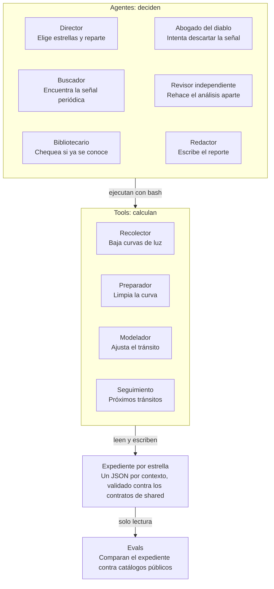

# Astronomy Hub: spec v0.1

Nov 26, 2026 · @JERO

## Objetivo y alcance

La v0.1 es un hub open source de agentes que busca tránsitos de exoplanetas en datos públicos de TESS y entrega, por cada estrella, un expediente verificable con veredicto y reporte.

**Entra en la v0.1**

- Una sola misión: exoplanetas por tránsito en curvas de luz de TESS.
- Seis agentes y diez contextos sobre Claude Managed Agents.
- Evals automáticos contra catálogos públicos, corridos por versión de agente.
- Todo por línea de comandos.

**Queda afuera**

- Otras misiones (estrellas variables, transitorios, agujeros negros, anomalías). El diseño deja el lugar, no el código.
- Confirmar planetas. El hub produce candidatos; la confirmación requiere seguimiento con telescopios.
- Barridos masivos. La v0.1 corre de a una estrella o en lotes chicos.
- Interfaz gráfica y envío automático de candidatos a canales oficiales.

**Se considera terminada cuando**

1. `make hello` corre los seis agentes de punta a punta sobre WASP-18 b y recupera su período (cerca de 0,94 días) con error menor al 1%.
2. `make eval-dev` corre el set de evals y publica la tabla de métricas con la versión de cada agente.
3. Los umbrales de la sección Evals se cumplen en el set reservado.
4. No hay secretos en el repo y toda sesión corre con presupuesto.

## Decisiones tomadas

Estas decisiones están cerradas para la v0.1; lo que sigue abierto está en Riesgos y preguntas abiertas.

| Tema | Decisión | Por qué |
| --- | --- | --- |
| Plataforma | Claude Managed Agents (beta), detrás de un adaptador `runtime/` | Sandbox, sesiones y multiagente ya resueltos; el adaptador permite correr en local más adelante |
| Agentes o tools | 6 agentes y 4 contextos que solo exponen tools | Agente donde hay criterio o hace falta contexto aislado; tool donde hay cálculo determinista |
| Qué es una tool | Un comando CLI del repo que el agente ejecuta con bash | Tiene que correr en el sandbox, junto a los datos. Las *custom tools* de la plataforma corren en la app cliente |
| Lenguaje | Python 3.12 en todo el repo | El ecosistema de astronomía es Python; un solo toolchain |
| Arquitectura | DDD y hexagonal por bounded context, repositories, casos de uso con un único `execute()` | Convención habitual del autor |
| Misión inicial | Exoplanetas por tránsito con TESS | Datos públicos y limpios, respuestas conocidas en catálogos, referencias open source |
| Comunicación entre contextos | Expediente en disco con contratos JSON | Los agentes comparten disco pero no contexto; los evals leen los mismos archivos |
| Modelos | `claude-opus-5-5` para Director, Abogado del diablo y Revisor; `claude-sonnet-5-5` para el resto | El criterio más fino va al modelo más capaz; se cambia en cada `agent.md` |
| Gasto | Presupuesto duro por sesión desde el primer día | Es un proyecto de prueba; el tope evita sorpresas |

## Arquitectura por contextos

Cada rol de astrónomo es un bounded context con la misma forma interna; seis tienen agente y cuatro solo exponen tools.



Los agentes ejecutan las tools con bash, las tools dejan su resultado en el expediente y los evals solo lo leen.

| Contexto | Rol | Tipo | Escribe en el expediente |
| --- | --- | --- | --- |
| `direction` | Director | Agente líder | `plan.json`, `decision.json` |
| `acquisition` | Recolector | Tools | `lightcurve/`, `star.json` |
| `preparation` | Preparador | Tools | `lightcurve_clean.parquet` |
| `detection` | Buscador | Agente | `search.json`, `signal.json`, `folds/` |
| `modeling` | Modelador | Tools | `model.json` |
| `catalog` | Bibliotecario | Agente | `catalog.json` |
| `vetting` | Abogado del diablo | Agente | `vetting.json` |
| `review` | Revisor independiente | Agente | `review.json` |
| `followup` | Seguimiento | Tools | `ephemeris.json` |
| `reporting` | Redactor | Agente | `report.md` |

El orden de trabajo es Director, Buscador, Bibliotecario, Abogado del diablo, Revisor y Redactor. El Director corta antes si no hay señal o si el objeto ya está catalogado.

**Estructura del repo**

```
astronomy-hub/
├── contexts/
│   ├── direction/      # Director (agente líder)
│   ├── acquisition/    # Recolector (tools)
│   ├── preparation/    # Preparador (tools)
│   ├── detection/      # Buscador (agente)
│   ├── modeling/       # Modelador (tools)
│   ├── catalog/        # Bibliotecario (agente)
│   ├── vetting/        # Abogado del diablo (agente)
│   ├── review/         # Revisor independiente (agente)
│   ├── followup/       # Seguimiento (tools)
│   └── reporting/      # Redactor (agente)
├── shared/
│   ├── kernel/         # StarId, LightCurve, Period: value objects comunes
│   ├── contracts/      # modelos pydantic de cada JSON del expediente
│   └── prompts/        # reglas comunes a todos los agentes
├── missions/
│   └── exoplanets/     # mission.yaml: objetivos, umbrales, set de evals
├── evals/              # build_set, runner, scorer; solo leen el expediente
├── runtime/            # adaptador a Managed Agents
├── scripts/            # build_dossier.py: el expediente completo sin LLM
├── tests/              # tests de shared y de arquitectura
├── docs/               # este spec
├── environment.yaml    # sandbox: hosts permitidos; generado desde uv.lock por scripts/build_environment.py
├── claude-lock.json    # IDs generados por ant apply (se commitea)
├── Makefile
└── .env                # fuera de git
```

**Forma de cada contexto**

```
contexts/vetting/
├── domain/             # Gate, GateResult, Verdict: puro, sin I/O
├── application/        # un caso de uso por archivo, con execute()
├── infrastructure/     # repositories y adaptadores (disco, catálogos)
├── cli.py              # expone cada caso de uso como tool
├── agent.md            # solo si el contexto tiene agente
└── tests/
```

**Reglas**

1. Un contexto no importa a otro. Solo depende de `shared/`, y un test de arquitectura lo verifica en CI.
2. `domain/` no hace I/O. `application/` orquesta puertos. `infrastructure/` los implementa.
3. Los contextos se comunican únicamente por el expediente.
4. Las tools son deterministas: misma entrada, misma salida, y se testean sin LLM ni red.
5. `runtime/` es el único lugar que conoce Managed Agents, y el único que importa `anthropic`.
6. Lo específico de la misión entra por `mission.yaml`, nunca hardcodeado en un contexto.
7. `evals/` no importa ningún contexto: solo lee el expediente con los contratos de `shared/`.

Las reglas de imports (1, 2, 5 y 7, más las capas `cli → infrastructure → application → domain` de cada contexto y que `shared/` no importe `contexts/`) las verifica import-linter. Un test sobre el AST falla si algún `domain/` importa módulos de I/O o llama a `open`, `input` o `print`.

## Expediente y contratos

El expediente es una carpeta por estrella donde cada contexto deja un archivo con formato fijo; es el único canal entre agentes y lo único que leen los evals.

```
workspace/exoplanets/<tic_id>/
├── plan.json                  # direction
├── lightcurve/                # acquisition: FITS crudos por sector, sNNNN.parquet y manifest.json
├── star.json                  # acquisition: parámetros de la estrella y vecinos
├── lightcurve_clean.parquet   # preparation
├── search.json                # detection: picos de BLS y armónicos descartados
├── signal.json                # detection
├── folds/                     # detection: datos y resumen de cada curva plegada
├── model.json                 # modeling
├── catalog.json               # catalog
├── vetting/runs.json          # vetting: cada corrida de cada prueba
├── vetting.json               # vetting
├── review/reproduction.json   # review: análisis independiente (TLS)
├── review.json                # review
├── ephemeris.json             # followup
├── decision.json              # direction
├── report.md                  # reporting
├── figures/                   # PNG de curvas plegadas y pruebas
├── log.jsonl                  # una línea por tool ejecutada
└── .cache/                    # cachés de astropy y astroquery de esta estrella
```

Todos los JSON comparten un sobre: `schema_version`, `tic_id`, `mission`, `produced_by` (contexto, tool, versión), `created_at`, `inputs` (hash de cada archivo leído) y `data`.

**Sobre**

| Campo | Forma |
| --- | --- |
| `schema_version` | Semver, por ejemplo `"0.1.0"` |
| `tic_id` | Entero positivo |
| `mission` | String (slug, por ejemplo `exoplanets`) |
| `produced_by` | `{context, tool, version}`; `context` es uno de los diez contextos |
| `created_at` | Fecha y hora siempre en UTC; se rechaza cualquier otra zona horaria |
| `inputs` | `{ruta_relativa: "sha256:<hex>"}` por cada archivo leído |
| `data` | El contenido propio de cada archivo, según la tabla de abajo |

Todos los modelos son inmutables y rechazan campos desconocidos (`extra="forbid"`). No se aceptan `NaN` ni infinitos.

| Archivo | Campos principales de `data` |
| --- | --- |
| `signal.json` | `detected`, `period_days`, `epoch_btjd`, `duration_hours`, `depth_ppm`, `snr`, `n_transits`, `sectors`, `method`, `other_peaks` |
| `model.json` | `method` (`quick`, `mcmc`), `rp_rs`, `planet_radius_rearth`, `impact_parameter`, `a_rs`, `period_days`, `epoch_btjd`, `duration_hours`, `jitter_ppm` como `Measurement`, `stellar_source`, `convergence` |
| `star.json` | `ra_deg`, `dec_deg`, `tmag`, `teff_k`, `logg`, `radius_rsun`, `mass_msun`, `contamination_ratio`, `source`, `neighbor_radius_arcsec`, `neighbors` |
| `lightcurve/manifest.json` | `flux_column`, `available_sectors`, `selection_rule`, `sectors` (archivo FITS, tabla extraída, cadencias, puntos válidos, inicio y fin) |
| `search.json` | `method`, `sectors`, `period_min_days`, `period_max_days`, `inverted_snr_max`, `peaks` (id, período, época, duración, profundidad, SNR, SDE, tránsitos), `discarded` (pico, motivo, `harmonic_of`, `ratio`) |
| `folds/<tag>.json` | Período, época y duración usados, profundidad por bin, pares contra impares, dispersión fuera de tránsito |
| `catalog.json` | `status` (`known_planet`, `toi`, `ctoi`, `known_false_positive`, `eclipsing_binary`, `unknown`), `matches` (catálogo, id, período, disposición, `period_match`, URL), `literature` |
| `vetting/runs.json` | Cada corrida de cada prueba: `gate`, `run`, `params`, `status`, `severity`, `value`, `threshold`, `note`, `metrics` |
| `vetting.json` | `gates` (`id`, `status`, `severity`, `value`, `threshold`, `note`, `n_runs`), `verdict` (`candidate`, `false_positive`, `inconclusive`), `rationale` |
| `review/reproduction.json` | Método de limpieza y de búsqueda, período, época, duración, profundidad, SDE y SNR independientes |
| `review.json` | `period_days_independent`, `depth_ppm_independent`, `disagreements`, `verdict` (`reproduced`, `partial`, `not_reproduced`), `rationale` |
| `ephemeris.json` | Período y época de referencia, fuente, inicio, próximos tránsitos (`n`, `mid_btjd`, `mid_utc`, `err_minutes`) |
| `decision.json` | `mode` (`explore`, `eval`), `final` (`no_signal`, `known`, `false_positive`, `candidate`, `inconclusive`), `reason`, `next_step` |

**Detalle de los contratos**

- `signal.json`: `period_days`, `epoch_btjd`, `duration_hours`, `depth_ppm`, `snr` y `n_transits` son opcionales en el tipo, pero un validador los exige con `detected=true` y los exige en `null` con `detected=false`. `sectors` (al menos uno), `method` y `other_peaks` van siempre. Cada elemento de `other_peaks` es `{period_days, snr, depth_ppm}`.
- `model.json`: cada parámetro es un `Measurement {value, err_lower, err_upper}`. Los errores son magnitudes no negativas: el intervalo es `[value - err_lower, value + err_upper]`.
- `catalog.json`: cada elemento de `literature` es `{title, url, note}`. `disposition` en `matches` es el valor del catálogo: `tfopwg_disp` de la lista TOI (`APC`, `CP`, `FA`, `FP`, `KP`, `PC` o vacío), la disposición TFOPWG de la CTOI, o `CONFIRMED` para `pscomppars`. `period_match` dice si el período del match coincide con el de `signal.json` (1% o razón entera, alias incluidos); es `null` si no hay señal o el match no trae período.
- `vetting.json`: cada gate tiene `id` como slug (no número), `status` (`pass`, `fail`, `marginal`), `severity` (`hard`, `soft`, `info`), `value` y `threshold` como `float | None`, y `n_runs`, la cantidad de corridas combinadas. Las severidades están en la tabla de las diez pruebas.
- `model.json`: `planet_radius_rearth` y `stellar_source` son opcionales y van juntos. Si `star.json` no trae el radio estelar con su error, el ajuste termina bien, ambos quedan en `null` y la tool lo avisa en el resumen. Si lo trae, el error del radio estelar se propaga al del planeta.
- `star.json`: cada parámetro estelar es un `Measurement` y solo se registra si el TIC trae el valor con su error; si no, queda en `null`. Los vecinos son `{tic_id, separation_arcsec, tmag}`, ordenados por separación.
- `search.json`: los picos con profundidad no positiva y los armónicos de un pico mejor rankeado no entran en `peaks`, pero quedan en `discarded` con su motivo (`non_positive_depth` o `harmonic`) y, si es armónico, con el id del pico que se quedó y la razón entre períodos (por ejemplo `"2/1"`).
- Un pico es armónico de otro mejor rankeado si la razón entre sus períodos coincide, dentro de `harmonic_tolerance`, con un múltiplo o submúltiplo entero cualquiera, o con una fracción n/m con n, m ≤ `harmonic_max_integer`.
- `folds/<tag>.json`: la profundidad en tránsito y la de tránsitos pares e impares se miden tránsito por tránsito; su error sale de la dispersión entre tránsitos y no de la dispersión punto a punto, para que una diferencia sistemática entre sectores no parezca significativa. `n_odd` y `n_even` cuentan tránsitos.
- El SNR de un pico es `depth / depth_err` del BLS de astropy: es un SNR de ruido blanco, la misma definición que usa la prueba 3 del repo de referencia (`objective="snr"`). Como en una curva invertida BLS encuentra bajones de ruido con SNR por encima de `snr_min`, `search-period` corre la misma búsqueda sobre la curva invertida (`2 - flux`) y guarda su SNR máximo como `inverted_snr_max`, el piso de ruido de esa estrella. Antes enmascara los tránsitos del pico más fuerte (± `floor_mask_durations` duraciones): invertidos se vuelven jorobas que suben la media fuera de la caja, y cualquier caja en otro lado parece un bajón. En WASP-18 b, sin la máscara el piso daba 284; con ella da 39, contra un SNR de 1251 (lo que queda es la curva de fase, que invertida tiene bajones reales).
- Cada pico guarda también su SDE (`(power - media) / desviación` del periodograma). Es un dato para calibrar en M5; ninguna regla lo usa como umbral.
- `model.json`: `method` es `quick` (mínimos cuadrados, errores simétricos de la covarianza) o `mcmc` (emcee, percentiles 16-50-84). Los dos modelos tienen un término de jitter que se suma en cuadratura al error de cada punto, y lo informan en `jitter_ppm`. `duration_hours` es la duración total T14 derivada de los parámetros. `convergence` (`tau_max`, `n_post_burn`, `autocorr_factor`, `converged`, `acceptance_mean`, `acceptance_min`) va solo con `mcmc`.
- `review.json`: `verdict` tiene su propio enum, distinto del de vetting, y reemplaza al booleano `reproduced`. Con `reproduced`, `period_days_independent` y `depth_ppm_independent` son obligatorios; en los otros casos pueden ir en `null`. `disagreements` es una lista de strings que calcula la tool.
- `vetting.json`, `review.json` y `decision.json` llevan la justificación del agente (`rationale` o `reason`), pero el veredicto lo calcula la tool con una regla del dominio (ver Decisiones de los agentes).

**Regla del Director para `decision.json`**

Cuando el caso llega a Vetting y Review, `final` sale de esta regla y no de un promedio de opiniones:

- `candidate` solo si `vetting.verdict = candidate` y `review.verdict = reproduced`.
- `false_positive` si `vetting.verdict = false_positive`.
- `inconclusive` en cualquier otro caso.

Los cortes anteriores (`no_signal` después de Detection, `known` o `false_positive` después de Catalog) siguen como están en el prompt del Director. En modo `explore`, Catalog corta con `known` si hay un planeta confirmado, un TOI o una CTOI con `period_match`, y con `false_positive` si el match con `period_match` es un falso positivo conocido (`FP`, `FA`) o una binaria eclipsante. Un TOI o una CTOI con otro período no corta: el caso sigue y la nota queda en `catalog.json`. En modo `eval`, Catalog no corta nunca.

**Decisiones de los agentes**

Mismo patrón que `select-peak`: cada contexto con criterio tiene una tool que calcula el veredicto con una regla del dominio y recibe del agente solo la justificación.

| Contexto | Tool | Regla |
| --- | --- | --- |
| `vetting` | `conclude --rationale` | Combina las corridas de cada prueba (todas `pass` es `pass`, todas `fail` es `fail`, todas `not_evaluable` es `not_evaluable`, otra mezcla es `marginal`). Una prueba `hard` en `fail` da `false_positive`; todo en `pass` da `candidate` nivel A; sin prueba `hard` en `fail`, `marginal` ni `not_evaluable` y sin `soft` en `fail`, con solo `soft` en `marginal` o `not_evaluable`, da `candidate` nivel B; lo demás, `inconclusive`. `not_evaluable` es falta de datos (menos de 2 tránsitos pares o impares, un solo sector para el holdout, sin radio o masa estelar, pocos puntos de centroide); `marginal` es evidencia ambigua. `decide` copia el nivel y lista los reparos en `decision.json`. Las pruebas `info` no entran (fase A de M5) |
| `review` | `conclude --rationale` | Período independiente dentro de `period_tolerance` y profundidad dentro de `depth_tolerance` de `signal.json` da `reproduced`; período dentro de la tolerancia con otra profundidad, o un alias entero del período, da `partial`; si no, `not_reproduced` |
| `direction` | `decide --mode --reason` | La regla del Director de arriba; `next_step` sale de una plantilla de `mission.yaml` |

Las tres tools (y `fit-transit --mode mcmc`) rechazan (exit 2) archivos calculados sobre otro `signal.json`: comparan el hash de `inputs` con el del archivo actual. El hash es del archivo, no de `data`, así que volver a correr `select-peak` con el mismo pico (cambia `created_at`) también obliga a rehacer lo que sigue: es la opción estricta y coincide con lo que registra `inputs`.

- Los contratos viven en `shared/contracts/` como modelos pydantic. Cada tool valida al escribir y los evals validan al leer.
- Un agente nunca edita a mano el JSON de otro contexto.
- `log.jsonl` registra comando, versión, duración y hash de salida, para poder reproducir cualquier expediente. Cada línea es un `LogEntry`: `ts`, `context`, `tool`, `argv`, `version`, `duration_s`, `exit_code`, `outputs` (ruta y hash), `summary` (el mismo resumen que va a stdout), `reason` (opcional, por ejemplo el `--reason` de `select-peak`) y `error`.
- `produced_by.version` es `0.1.0+g<sha corto>`, con el sufijo `.dirty` si el árbol tiene cambios sin commitear, o `0.1.0` si no hay git. El hash de salida de un JSON se calcula sobre `data` serializado en forma canónica, no sobre el sobre: dos corridas iguales dan el mismo hash aunque cambie `created_at`.
- Cada sesión arranca con disco vacío. Al terminar, el Director empaqueta el expediente con `package-dossier` en `/mnt/session/outputs/dossier-<tic>.tar.gz` y `runtime/` lo baja.

## Tools

Una tool es un caso de uso expuesto como comando; toda la astronomía vive acá y no en los prompts.

**Convención**

- Se invoca como `python -m contexts.<contexto>.cli <tool> --tic <id> --workspace <dir> [--mission exoplanets]`. `--workspace` es la raíz (por defecto `workspace/`); el expediente queda en `<workspace>/<misión>/<tic_id>/`.
- `cli.py` solo parsea argumentos y llama al `execute()` del caso de uso.
- Lee y escribe únicamente en el expediente. Por stdout devuelve un resumen JSON de pocas líneas, para no llenar el contexto del agente.
- Códigos de salida: 0 correcto, 2 entrada inválida, 3 dato no disponible. El error va a stderr en una línea legible.
- Es idempotente y usa semilla fija donde hay azar.
- Agrega una línea a `log.jsonl`.
- Los umbrales y parámetros que usa salen de `mission.yaml`, validado por el schema de `shared/mission.py`.
- Las descargas van al expediente. Las cachés de astropy y astroquery se redirigen a `<expediente>/.cache/`, el caché de fuentes de matplotlib a `<workspace>/.cache/matplotlib` y los kernels compilados de numba (wotan, transitleastsquares) a `<workspace>/.cache/numba`, compartidos entre estrellas; nada se escribe en cachés globales ni en `site-packages`.

| Contexto | Tool | Qué hace | Librería sugerida |
| --- | --- | --- | --- |
| `direction` | `select-targets` | Lista los TIC a procesar según los criterios de la misión | astroquery |
| `direction` | `registry` | Registra estrellas ya procesadas para no repetirlas | (propia) |
| `acquisition` | `fetch-lightcurves` | Baja las curvas SPOC de 2 minutos de los sectores elegidos por la regla de `mission.yaml` y extrae `PDCSAP_FLUX`, descartando puntos con NaN o `QUALITY` distinto de 0 | astroquery, astropy |
| `acquisition` | `fetch-star` | Trae parámetros de la estrella y sus vecinas cercanas | astroquery |
| `preparation` | `clean` | Normaliza por sector, quita la tendencia, recorta outliers hacia arriba y une sectores | wotan |
| `detection` | `search-period` | Busca períodos con BLS y escribe en `search.json` los mejores picos con su SNR y su SDE; descarta los de profundidad no positiva y los armónicos, dejándolos anotados. Repite la búsqueda sobre la curva invertida y guarda su SNR máximo | astropy |
| `detection` | `select-peak` | Registra la elección del Buscador: escribe `signal.json` desde `search.json` con `--peak <id>` o `--no-signal`. Rechaza un pico con SDE bajo `sde_min` o con menos de `min_transits` tránsitos. Acepta `--reason`, que va a `log.jsonl` | (propia) |
| `detection` | `fold` | Pliega la curva en un pico de `search.json` o en un período dado; guarda datos, figura y un resumen numérico que también imprime por stdout | astropy, matplotlib |
| `modeling` | `fit-transit` | Ajusta un modelo de tránsito con jitter. `--mode quick` (por defecto) usa mínimos cuadrados y tarda segundos; `--mode mcmc` usa emcee, informa la convergencia y solo corre si `vetting.json` dice `candidate` | batman, scipy, emcee |
| `catalog` | `crossmatch` | Busca el TIC en `pscomppars` y en la lista TOI del NASA Exoplanet Archive (TAP) y en las CTOI de ExoFOP; marca qué matches coinciden en período con `signal.json` | urllib |
| `vetting` | `run-gates` | Corre las diez pruebas de descarte y escribe una corrida de cada una en `vetting/runs.json` | (portado) |
| `vetting` | `run-gate` | Repite una prueba con otros parámetros de medición (`--duration-scale`, `--window-durations`, dentro de los rangos de `mission.yaml`); los umbrales no se tocan. Repetir con los mismos parámetros no agrega una corrida | (portado) |
| `vetting` | `conclude` | Combina las corridas, calcula el veredicto y escribe `vetting.json` con el `--rationale` del agente | (propia) |
| `review` | `reproduce` | Rehace limpieza (otro detrending) y búsqueda (TLS) desde las tablas por sector, sin leer `signal.json` | wotan, transitleastsquares |
| `review` | `conclude` | Compara `review/reproduction.json` con `signal.json`, calcula el veredicto y escribe `review.json` con el `--rationale` del agente | (propia) |
| `followup` | `ephemeris` | Calcula los próximos tránsitos con su incertidumbre desde `model.json`, a partir de `--start` (por defecto, hoy en UTC) | astropy |
| `direction` | `decide` | Calcula `final` con la regla del Director y escribe `decision.json` con el `--reason` del agente | (propia) |
| `reporting` | `render-report` | Arma `report.md` desde el expediente con una plantilla; acepta un `--summary` del agente | jinja2 |

**`mission.yaml`**

Cada tool lee de `missions/<misión>/mission.yaml` los parámetros que consume, con una sección por contexto. El schema vive en `shared/mission.py` y rechaza claves desconocidas. Los valores son parámetros de diseño, no datos de ninguna estrella. Los umbrales calibrados en la fase A de M5 (`sde_min`, la densidad de respaldo, el factor de excentricidad, centroide, par-impar y secundario) llevan su consulta o su curva junto al parámetro.

Regla de selección de sectores (`acquisition.sector_selection.rule: longest_consecutive_run`), determinista y con preferencia por sectores consecutivos:

1. De los sectores SPOC de 2 minutos disponibles, se arman las corridas de números de sector consecutivos.
2. Se elige la corrida más larga; si hay empate, la más reciente.
3. Si la corrida tiene más de `max_sectors`, se quedan sus `max_sectors` sectores más recientes.
4. No se agregan sectores de otras corridas: un baseline compacto mantiene chica la grilla de BLS.

Solo cuentan como disponibles las observaciones SPOC de un sector. MAST también lista productos multisector de Data Validation (por ejemplo `s0001-s0036`) con el último sector como `sequence_number`; no traen curva y se ignoran.

**Notas de implementación de M1**

- `fetch-lightcurves` deja los FITS crudos en `lightcurve/` y, por sector, una tabla `sNNNN.parquet` con `PDCSAP_FLUX` sin NaN ni `QUALITY` distinto de 0. La tabla guarda también el centroide ponderado por flujo (`MOM_CENTR1`, `MOM_CENTR2`, en píxeles) para la prueba 8; puede ser NaN. `clean` lee esas tablas a través de `lightcurve/manifest.json` y nunca los FITS.
- `search-period` examina como máximo `examine_factor` × `n_peaks` picos distintos (4 × 5), para que la lista de descartados no crezca sin límite en una estrella sin señal.
- `peak_separation: 0.02`: con un sector y duraciones de 6 h, los lóbulos laterales del BLS llegan a ~1% del período.
- `fold` escribe, además de los datos y la figura, `folds/<tag>.json` validado con el mismo resumen que imprime por stdout. Las profundidades se miden tránsito por tránsito: con errores punto a punto, WASP-18 b mostraba una diferencia par/impar espuria de 5,9σ (1,6σ con dispersión entre tránsitos). El error de los pares sale solo de la dispersión entre tránsitos pares, y el de los impares solo de los impares: mezclar los dos grupos inflaría el error de una binaria con eclipses alternados y escondería la diferencia. La medición vive en `shared/kernel/transits.py` y la usan `fold` y la prueba 5.
- batman 2.5.3 importa `distutils`, que Python 3.12 ya no trae; `setuptools` aporta el reemplazo.

**Notas de implementación de M2**

- Las duraciones que prueba BLS se limitan por período a lo físicamente posible: `T_max(P) = (P/π)·asin(min(1, (1 + rp_rs_max)·R*/a))`, con `R*/a = (3π / (G ρ_min P²))^(1/3)` por la tercera ley de Kepler (G y la densidad solar salen de `astropy.constants`) y `ρ_min = stellar_density_min_solar` de `mission.yaml`, una envolvente para cualquier estrella de la misión. **Cambio de la fase A de M5:** con `ρ_min = 0,05` el límite no recortaba nada (toda duración de la grilla era posible en todo el rango de períodos) y las falsas detecciones en estrellas sin señal eran picos de 6 h con órbitas que rozan la estrella (a/R* implícita entre 1,0 y 1,65). Ahora la densidad es la de la propia estrella cuando `star.json` trae radio y masa del TIC (el extremo bajo de su intervalo, `M − σ` sobre `(R + σ)³`), y si no, el respaldo `ρ_min = 0,144`, el percentil 5 de `st_dens` de las 3689 estrellas con planetas en tránsito del NASA Exoplanet Archive (no un valor ajustado a la muestra). El límite circular se multiplica por `eccentricity_factor = 1,264`, la duración relativa de un tránsito en el apoastro con e = 0,23 (percentil 95 de `pl_orbeccen` de los planetas en tránsito con P entre 0,5 y 15 d). Las dos consultas están en `mission.yaml`. Esto revierte la decisión de M1 de no leer `star.json`: la búsqueda ahora depende de que `fetch-star` corra antes (el Buscador ya lo hace en ese orden); si falta, usa el respaldo, y `search.json` registra la densidad usada y su fuente.
- Con el piso de ruido, `search-period` corre BLS dos veces: con los cuatro sectores de WASP-18 b tarda unos 24 segundos.
- Los adaptadores de MAST (y los de catálogos) reintentan los errores transitorios (conexión, timeout, HTTP 5xx) con backoff exponencial (`retry.attempts`, `retry.backoff_s`); agotados los intentos, la tool sale con exit 3.
- `fit-transit --mode quick` ajusta por mínimos cuadrados con el jitter reestimado desde los residuos (tres pasadas) y saca los errores de la covarianza, muestreada con semilla fija para propagarlos a a/R*, T14 y el radio. En WASP-18 b el jitter da unos 456 ppm: la dispersión real (752 ppm) supera a los errores de PDCSAP (537 ppm).
- `fit-transit --mode mcmc` corre por defecto 10000 pasos con 2000 de burn-in. En M1, sin jitter, 8000 pasos convergían (τ_max ≈ 103); con el jitter como noveno parámetro τ_max sube a ≈ 142 y 8000 ya no alcanzaban 50 τ. Con 10000 converge (8000 pasos después del burn-in contra 50 τ ≈ 7100) en unos 5 minutos. Arranca desde el óptimo de mínimos cuadrados. Por eso el modo por defecto es `quick` (menos de un segundo, mismos valores dentro de los errores en WASP-18 b) y el MCMC queda para los candidatos que pasaron vetting, y solo en modo `explore`: las métricas de los evals no lo usan.
- `reproduce` limpia con mediana móvil de 1 día (no biweight de 0,75) y busca con TLS sobre bins de 10 minutos; `detected` exige SDE ≥ `sde_min` (9: falsa alarma de 1,6 × 10⁻⁴ según la tabla del propio paquete). Las advertencias de TLS van al resumen, no a stderr. La profundidad de TLS se mide en el fondo del tránsito y la de BLS es la media de la caja, así que la de TLS sale más alta: en WASP-18 b, 1,16 veces. Desde la fase A de M5, `conclude` compara igual con igual: la profundidad de caja (media pesada fuera menos dentro de la caja) medida por `reproduce` sobre la curva del propio Revisor, con su período y su época y el ancho de caja de mejor SNR entre 0,4 y 1,0 de la duración de TLS (como elige BLS; la T14 entera incluye entrada y salida y daba profundidades 25% más bajas), contra la de `signal.json`, con margen de 20%. Además exige coincidencia de época: el tránsito del Revisor más cercano a la época de `signal.json` tiene que caer a menos de `epoch_tolerance_durations` (0,5) duraciones; mismo período en otros momentos es `partial`. La independencia está en la limpieza y en el algoritmo de búsqueda, no en cómo se mide la profundidad. Con los cuatro sectores tarda unos 14 segundos.
- `render-report` necesita `decision.json`, porque el reporte empieza por el veredicto: `decide` corre antes que `render-report` (el prompt del Director de M3 tiene que respetar ese orden). La plantilla (`contexts/reporting/infrastructure/templates/report.md.j2`) pone la fuente de cada número, dice qué archivos faltan y cierra con las limitaciones de la v0.1 y la procedencia de cada archivo.
- `decide` lee solo lo que la regla necesita, en su orden: en modo `explore`, `catalog.json`; si no corta, `vetting.json`; si no es `false_positive`, `review.json`. En modo `eval` no lee `catalog.json` aunque exista. Así, archivos de una corrida anterior que la regla no necesita nunca se consultan. `render-report` deja afuera, con una nota, las secciones calculadas sobre otro `signal.json`. Los textos de `next_step` están en `mission.yaml` (`direction.next_steps`).
- `scripts/build_dossier.py` (`make dossier`) corre cada tool por subprocess, como un agente con bash, y reemplaza cada elección por una regla fija: el primer pico que acepta `select-peak`, sin repeticiones de pruebas, rationales fijos. Si vetting da `false_positive` no corre el MCMC ni `reproduce`. En modo `eval` no corre el MCMC (las métricas no lo usan) y `crossmatch` corre después de `decide`. Con WASP-18 b completo y el MCMC por defecto tarda unos 6 minutos, 5 de ellos del MCMC.
- wotan y transitleastsquares compilan kernels de numba con `cache=True`; se importan dentro de las funciones porque numba fija el directorio de caché al decorar, y `isolated_caches` lo apunta antes a `<workspace>/.cache/numba`. En los tests va a `.pytest_cache/numba`.

**Notas de implementación de M3**

- `make hello` (eval) con WASP-18 b, sesión `sesn_019BVuamXrMwmuQLdSogzDBv`: termina en `candidate`, período 0,94144 d (dentro del 1%), las seis tools escribieron contratos válidos y los seis agentes trabajaron. Costo de lista 0,82 USD, 284 segundos activos. Por agente: Director 0,22, Abogado del diablo 0,16, Bibliotecario 0,15, Revisor 0,12, Redactor 0,10 y Buscador 0,07 USD. Casi todo el input es caché (756 mil tokens leídos de caché, 126 sin caché, 14 mil de salida).
- `make hello MODE=explore`, sesión `sesn_018viDKfS7S9W4YmAbQBYHNW`: corta en `known` después del Bibliotecario, sin Abogado ni Revisor. 0,33 USD, 229 segundos.
- La primera auditoría marcó 15 de 39 comandos y eran falsos positivos: cortaba en `|`, `;` y `>` dentro de comillas. Con un tokenizador de shell (`python -m runtime.audit runs/<run_id>` recalcula una corrida guardada) da 0. Los 39 comandos son tools del repo o lecturas.
- `bin/setup-sandbox` tardó 16 y 30 segundos en las sesiones reales (8 en la sonda).
- Los agentes gastaron algunas llamadas en adivinar la sintaxis (`bin/hub exoplanets ...`) y el Revisor exploró el repo buscando cómo validar. Es materia de M5.
- `ant apply` no borra un campo omitido: para vaciar los paquetes del environment hubo que escribir `packages: {pip: []}`.
- La línea de `package-dossier` en `log.jsonl` se escribe después de armar el tar, así que no viaja en el expediente bajado.

**Notas de implementación de M4**

- Set v0.1 (`sha256:1e6dd2d2…`), armado el 26 de noviembre de 2026 en 11 minutos: 50 estrellas con las cuotas exactas. Se descartaron 8 candidatos por falta de curvas SPOC verificadas o de tránsitos suficientes. Se reconstruye byte por byte desde el snapshot.
- `make eval-baseline` corre en unos 20 minutos con 3 procesos, unos 63 segundos por estrella. Un caché de numba compartido entre procesos hizo que `review reproduce` muriera con segfault (-11), así que cada proceso usa su propio workspace. En el sandbox las tools corren de a una y no pasa.
- Baseline: los planetas profundos se detectan bien (100% en desarrollo, 75% en reservadas), pero el recall final es bajo (33% y 25%). Los planetas inconclusos tienen dos causas principales: el Revisor da `partial` con vetting `candidate` (5 de 9) y la prueba `coverage` falla (4 de 9, estrellas con un solo sector). Ningún error grave, ningún alias y una falsa aceptación de falso positivo entre las reservadas.
- Bug encontrado en el baseline: `fit-transit` falla en 2 de las 10 estrellas sin señal. `select-peak` aceptó un pico de variabilidad (P en 0,5 o 1,1 d con la duración en el techo de 6 h) y el modelo calcula `acos(b/a)` con b > a (`math domain error`) o no deja muestras válidas. Queda para M5; arreglarlo antes del piloto habría puesto al baseline y al piloto en versiones distintas de las tools.
- El Director de eval necesitó un agente aparte: la plataforma rechaza crear la sesión (400) si algún agente del roster tiene dominios web fuera de los `allowed_hosts` del environment, aunque nunca se lo llame.
- Piloto de 5 estrellas de desarrollo con agentes: 1,21 USD (0,11 a 0,48 por estrella; el planeta que recorre toda la cadena es el más caro), unos 2 minutos activos por estrella, sin errores de plataforma ni reintentos. Los agentes eligieron igual que el script en 4 de 5 y mejor en 1, un falso positivo que el script dejó `inconclusive`. La auditoría marcó una lectura que era un `2>/dev/null` mal tokenizado; corregido, y `--reaudit` recalcula las corridas guardadas sin lanzar sesiones.
- La línea de `package-dossier` en `log.jsonl` ahora viaja dentro del tar.

**Notas de la fase A de M5 (reglas contra el baseline, sin créditos)**

- Se calibra solo contra el set de calibración (`v0.1-calib`, 150 estrellas: 30 planetas profundos, 30 chicos, 60 falsos positivos y 30 sin señal, mismos filtros, sin repetir las 50) y la partición de desarrollo; el reservado no se corre ni se abre. Cada cambio va en su commit con su antes y después (`evals.rules --stage detection | vetting | fix`).
- Regla de detección: SDE del pico elegido, calibrada reproduciendo `select-peak` sobre `search.json`. El SNR no separa planetas de estrellas sin señal (AUC 0,53); la razón contra el piso de la curva invertida, 0,77; el SDE, 0,81. Curva completa en calibración (planetas detectados en su período de catálogo de 60 / falsas detecciones de 30 estrellas sin señal): 6: 50/16 · 7: 50/10 · 7,5: 50/6 · 8 a 9: 49/4 · 9,25 a 9,5: 47/4 · 10: 46/3 · 11: 45/3 · 12: 42/3 · 13: 40/3 · 14 a 15: 38/2 · 16: 33/1 · 17: 32/0 · 18: 28/0 · 20: 21/0 · 25: 11/0 (la regla anterior, SNR ≥ 8: 47/16). `sde_min = 9` está en el borde superior de la meseta 8 a 9 (dos planetas tienen SDE entre 9 y 9,25); el centro sería 8,5, con el mismo resultado en calibración y desarrollo. Confirmado en desarrollo sin retocar: 8 de 12 planetas, 1 de 6 estrellas sin señal.
- Un error grave es solo un planeta descartado en su período de catálogo; una señal espuria descartada en una estrella con planeta es una detección perdida.
- Inconclusos por causa (`evals.verdicts`, sobre los resultados guardados): en los 30 planetas inconclusos de calibración dominan los pocos tránsitos (cobertura con menos de 6 tránsitos en 19, un solo sector en 16, menos de 2 tránsitos pares o impares en 13); el Revisor no reproduce en 4 y da `partial` en 3; par-impar por p de Welch solo en 2. En los 33 falsos positivos inconclusos dominan plausibilidad `marginal` (19: sin radio o masa en el TIC, o intervalo que cruza el máximo), un solo sector (13) y centroide `marginal` (12).
- Variantes de la regla de veredicto evaluadas sin volver a correr: (a) la actual; (b) dos niveles, A si pasa todo y B si no hay prueba dura en `fail` ni `marginal`, ninguna blanda en `fail`, el Revisor reproduce y solo hay blandas `marginal`. En calibración, A: recall final 0,32 (19 de 60), 3 falsos positivos aceptados; A+B: 0,38 (23), 4 aceptados. En desarrollo no cambia (0,50, 0 aceptados). Las 5 estrellas que suma B tienen como única marginal el holdout de un solo sector.
- Regla elegida: la (b) con el estado `not_evaluable`. La variante (c), que además admitía en B pruebas duras `not_evaluable` y la cobertura de 3 a 5 tránsitos como blanda `marginal`, subía el recall final de calibración a 0,63 pero aceptaba 10 de 60 falsos positivos (7 por plausibilidad sin radio ni masa estelar), por encima del tope del 10%. Implementada y medida, la (b) reproduce la evaluación sobre resultados guardados: nivel A igual que antes, A+B suma 4 planetas de un solo sector y 1 falso positivo en calibración.
- Objetivos (piso de regresión para el reservado y para las corridas con agentes, recalculados con la regla (b); entre paréntesis el baseline de calibración / desarrollo):

  | Grupo | Métrica | Piso |
  | --- | --- | --- |
  | Planetas profundos | recall de detección | ≥ 0,75 (0,83 / 0,83) |
  | Planetas profundos | recall final A / A+B | ≥ 0,30 / ≥ 0,33 (0,33 y 0,37 / 0,67 y 0,67) |
  | Planetas chicos | recall de detección | ≥ 0,65 (0,80 / 0,50) |
  | Planetas chicos | recall final A / A+B | ≥ 0,25 / ≥ 0,33 (0,30 y 0,40 / 0,33 y 0,33) |
  | Falsos positivos | aceptados A / A+B | ≤ 0,07 / ≤ 0,10 (0,05 y 0,07 / 0 y 0) |
  | Sin señal | falsas alarmas A / A+B | 0 / a lo sumo 1 de cada 10 (0 / 0) |
  | Todos | errores graves | 0 |

  En el reservado (4 profundos, 4 chicos, 8 falsos positivos, 4 sin señal) cada estrella mueve entre 12 y 25 puntos: se lee como "no peor que el baseline por más de una estrella". Los objetivos iniciales de la tabla Métricas (90% de detección, 80% de recall final) quedan como meta de largo plazo: con estas reglas, cerca de dos tercios de los planetas inconclusos lo son por pocos tránsitos o un solo sector.
- Primer `make eval-dev` (27 de noviembre): frenó a las 3 estrellas (1,06 USD). Dos corridas marcadas como contaminadas eran el Buscador envolviendo `fetch-lightcurves` en `timeout` y mirando procesos con `pgrep`, para protegerse del corte de 295 s de bash; la tercera quedó incompleta porque MAST falló (`RemoteServiceError`) o se colgó desde el sandbox. Arreglos: `fetch-lightcurves` tiene timeout de 60 s por pedido y un tope total de 240 s, trata `RemoteServiceError` como transitorio y sale con código 1 "MAST unavailable" (el 3 queda para "no hay datos"); la auditoría acepta `timeout` alrededor de una tool del repo y `pgrep` como solo lectura (nada más), y ya no toma la redirección tras un subshell por un programa; el runner reintenta una falla de MAST solo cuando MAST responde desde afuera y, con 3 estrellas seguidas fallando por MAST, pausa y reanuda hasta media hora después.
- Ideas pendientes, sin implementar (fase A cerrada sin ellas):
  - Que cada skill diga la ruta exacta de su archivo de salida (por ejemplo `workspace/exoplanets/<TIC>/review.json`), para que los agentes no lo busquen con `find`. No se cambió durante `eval-dev` para no invalidar las corridas ya hechas.
  - Límite de duraciones con k de la profundidad: hoy la cota usa `rp_rs_max = 0,3`, y para una señal de 60 ppm un k tan grande admite duraciones de órbitas que rozan la estrella (TIC 29253938 sigue detectada a P = 0,543 d con 4 h). Una cota con k ≈ √profundidad (con margen) descartaría esos picos.
  - Centroide por imagen diferencia (PRF sobre la diferencia en tránsito menos fuera de tránsito, desde los TPF), aplicado solo a las estrellas que terminarían en `candidate` (ver Riesgos).
  - `sde_min` queda en 9 aunque está en el borde superior de la meseta 8 a 9; 8,5 daría el mismo resultado en calibración y desarrollo.
  - Estrellas de un solo sector: cobertura pasa con ≥ 6 tránsitos, pero la prueba 4 queda `marginal` con un sector; la versión que deja afuera tránsitos de a uno se probó y se revirtió porque aceptaba 3 falsos positivos que pasan las diez pruebas.

**Las diez pruebas de descarte**

Se portan de [open-exoplanet-hunt](https://github.com/Th0rgal/open-exoplanet-hunt) (licencia MIT, con atribución), junto con sus controles negativos sintéticos. Los umbrales son los de la referencia salvo donde se indica, y viven en `mission.yaml` (`vetting.gates`) junto con la severidad de cada prueba.

| # | Id | Prueba | Severidad | Pasa si |
| --- | --- | --- | --- | --- |
| 1 | `catalog` | Duplicado en catálogos de planetas, TOI y CTOI | `info` | No hay match con `period_match` en `catalog.json`; si no hay `catalog.json` (modo eval), queda `marginal` con nota y no entra al veredicto |
| 2 | `coverage` | Tránsitos suficientes con datos | `soft` | ≥ 6 tránsitos con datos, en uno o más sectores; con un solo sector, la nota dice que la repetición entre sectores no se prueba (eso es de la prueba 4 cuando hay varios). Cambiado en la fase A de M5: antes exigía ≥ 2 sectores |
| 3 | `detection` | Regla de detección | `soft` | SDE de la señal ≥ `sde_min` (9). El SNR y el piso de la curva invertida se informan como dato. Cambiado en la fase A de M5 (antes `snr`: SNR ≥ 8 y por encima del piso); ver la calibración en Notas de la fase A |
| 4 | `holdout` | Predicción a ciegas dejando un sector afuera (la referencia lo llama época) | `soft` | Z mínimo ≥ 2 y Z medio ≥ 3,5 en los sectores retenidos |
| 5 | `odd-even` | Profundidades de tránsitos pares e impares | `hard` | t de Welch sobre las profundidades por tránsito; el error de cada grupo es el mayor entre el fotométrico y la dispersión entre sus tránsitos, y los grados de libertad de Welch–Satterthwaite hacen que con pocos tránsitos haga falta más evidencia. Falla con p < 0,0027 (3σ normal de dos colas) y queda `marginal` con p < 0,05. Cambiado en la fase A de M5: la regla anterior (2,5σ como si fuera normal) descartaba 3 planetas confirmados con 2 a 7 tránsitos por grupo y p de Welch entre 0,022 y 0,11; los falsos positivos que rechaza tienen p entre 6·10⁻¹⁰ y 1,6·10⁻³ |
| 6 | `secondary` | Eclipse secundario en fase 0,5 | `hard` | Se compara con la ocultación más profunda que podría mostrar un planeta que hace ese tránsito, del lado permisivo: albedo geométrico 1 más un lado diurno a la temperatura sin redistribución y con albedo de Bond 0, con el menor a/R* (el del ajuste o el de la densidad estelar), el mayor cociente de radios (tope 0,3) y la Teff más alta (sin Teff, la de la estrella más caliente con un planeta en tránsito, 15 900 K); Planck y constantes de astropy, banda TESS rectangular de 600 a 1000 nm. Falla solo si el secundario es significativo (≥ 2,5σ) y su extremo inferior a 3σ supera 2 veces esa cota; significativo y por encima de la cota sin ese margen queda `marginal`; por debajo pasa con nota. Cambiado en la fase A de M5: la regla anterior (menos del 30% del primario) dejó llegar a `candidate` a dos binarias eclipsantes |
| 7 | `plausibility` | Radio y duración físicamente plausibles | `hard` | Radio: `marginal` por encima del percentil 99 de los planetas confirmados (`planet_radius_marginal_rjup`, 1,64 R♃: "más grande que el 99% de los planetas conocidos") o si el intervalo cruza el máximo confirmado; falla solo si el límite inferior del intervalo supera el planeta confirmado más grande (`planet_radius_max_rjup`, 2,62 R♃), así que un planeta confirmado nunca falla por su radio. Duración / duración circular con b = 0 entre 0,2 y 2,2. Sin radio estelar en el TIC, decide solo la duración y la nota lo dice |
| 8 | `centroid` | Centroide estable, para descartar una binaria de fondo | `hard` | Falla solo con evidencia fuerte en las dos cosas: significancia empírica ≥ 5 (contra la misma medida en 300 épocas falsas al azar, que absorbe ruido correlacionado y sistemáticos) **y** una vecina del TIC a una distancia de 0,5 a 2 veces el offset implícito (corrimiento / profundidad) capaz de producir la profundidad. Con significancia empírica ≥ 3 sin eso queda `marginal`. Cambiado en la fase A de M5: la regla anterior (3σ de ruido blanco o 2,5″) descartaba 4 planetas confirmados con corrimientos de 0,007 a 0,11″ y sin ninguna vecina capaz de producir el tránsito |
| 9 | `coherence` | Coherencia tránsito a tránsito y estabilidad por jackknife | `soft` | ≥ 70% de tránsitos positivos, SNR sin el tránsito más fuerte ≥ 6,5 y mediana por tránsito ≥ 0,55 de la profundidad |
| 10 | `rotation` | Guarda contra modulación por rotación de la estrella | `soft` | Amplitud sinusoidal fuera de tránsito (en P, sus fracciones y la serie de 4 armónicos) < 0,32 de la profundidad en la curva limpia y < 3,5 en la cruda |

- Con datos insuficientes para medir (pocos tránsitos, sin centroides, un solo sector en la prueba 4), la prueba queda `marginal` con nota: nunca falla por falta de datos.
- En la referencia, el docstring de la prueba 6 dice "< 2,5σ o < 30% del primario", pero el código solo mira la significancia. Se sigue el docstring. El secundario se mide contra una base local alrededor de la fase 0,5, igual que el primario, para que la curva de fase de un Júpiter caliente no lo sesgue.
- Los dos umbrales de radio salen del NASA Exoplanet Archive (`pscomppars`, `tran_flag=1`, consultado el 26 de noviembre de 2026): `planet_radius_marginal_rjup: 1.64` es el percentil 99 de `pl_radj` entre los planetas con error relativo de radio menor al 20% (3562 de 4452 con errores), y `planet_radius_max_rjup: 2.62` es el mayor `pl_radj` confirmado (Kepler-1979 b). Un percentil solo como límite duro haría fallar, por definición, al 1% de los planetas confirmados (HAT-P-67 b, 2,14 ± 0,025 R♃, por ejemplo); por eso por encima del percentil la prueba queda `marginal` y solo falla por encima del máximo. La referencia usa 18 R⊕ (unos 1,6 R♃) como límite duro. Las dos consultas quedan junto a los parámetros en `mission.yaml`.
- `run-gate` solo cambia parámetros de medición (`duration_scale` y `window_durations`, con rango en `mission.yaml`); las pruebas 1, 2, 3 y 7 no miden fotometría propia (leen `catalog.json`, cuentan tránsitos, leen el SNR guardado o el modelo) y rechazan la repetición.
- `run-gates` imprime el veredicto que daría `conclude` (`verdict_if_concluded`), para que el agente sepa qué pruebas repetir.
- Con WASP-18 b, las diez pruebas pasan tanto con los cuatro sectores completos como con el fixture de 2 × 5 días. El secundario sale significativo (28,7σ y 10,7σ) y del 5% del primario: pasa con nota.

**Skills**

Cada contexto tiene `contexts/<contexto>/skill/SKILL.md` con sus tools, cuándo usar cada una, cómo leer su salida y los umbrales de la misión. Ahí va el conocimiento de dominio que se destile de las referencias. Cada skill se sube con `ant apply` y se adjunta por ruta solo a los agentes que usan esas tools. No se usa `.claude/skills/`: montar el repo en una sesión cargaría todas las skills en todos los agentes, y además se cargan en las sesiones locales de Claude Code.

## Agentes

Seis agentes: el Director coordina y delega en cinco especialistas, con un solo nivel de delegación.

| Agente | Contexto | Modelo inicial | Tools propias | Usa también tools de | Web |
| --- | --- | --- | --- | --- | --- |
| Director | `direction` | `claude-opus-5-5` | `decide`, `package-dossier` (`select-targets` y `registry` quedan para M4) | ninguna; delega | No |
| Buscador | `detection` | `claude-sonnet-5-5` | `search-period`, `select-peak`, `fold` | `acquisition`, `preparation`, `modeling` | No |
| Bibliotecario | `catalog` | `claude-sonnet-5-5` | `crossmatch`, `add-literature` | ninguna | Sí |
| Abogado del diablo | `vetting` | `claude-opus-5-5` | `run-gates`, `run-gate`, `conclude` | `detection` (`fold`) | No |
| Revisor independiente | `review` | `claude-opus-5-5` | `reproduce`, `conclude` | ninguna | No |
| Redactor | `reporting` | `claude-sonnet-5-5` | `render-report` | `followup` | No |

**Configuración**

- Todos usan el toolset `agent_toolset_20260401` con `bash`, `read`, `glob` y `grep`. `write` y `edit` quedan apagados, así que un agente no puede editar a mano un archivo del expediente con esas herramientas. Búsqueda y fetch web quedan apagados salvo en el Bibliotecario, limitados con `allowed_domains`.
- Política de permisos `always_allow`: las corridas son desatendidas. Vale mientras se cumplan tres condiciones: red `limited`, ningún vault ni token montado en la sesión (el repo es público) y presupuesto por sesión. Si alguna cambia, se revisa antes.
- Solo el Director lleva el bloque `multiagent`, con los cinco especialistas como agentes predefinidos, los agentes inline deshabilitados y los workflows dinámicos apagados (el pipeline es fijo y el presupuesto es chico).
- Cada `agent.md` vive en su contexto y se publica con `ant apply`. Cada cambio de prompt genera una versión nueva, que los evals registran.

Esquema del bloque `multiagent` del Director, verificado contra la documentación de orquestación y de `ant apply` (que cambia cada ruta por `{type: agent, id, version}`):

```yaml
---
name: Astronomy Hub Director
model: claude-opus-5-5
tools:
  - type: agent_toolset_20260401
    configs:
      - name: web_search
        enabled: false
      - name: web_fetch
        enabled: false
multiagent:
  type: multiagent_20261001
  subagents:
    type: enabled
    inline_agents:
      type: disabled
    predefined_agents:
      - ../detection/agent.md
      - ../catalog/agent.md
      - ../vetting/agent.md
      - ../review/agent.md
      - ../reporting/agent.md
  workflows:
    type: disabled
---
```

**Reglas comunes** (`shared/prompts/common.md`, incluidas en todos los prompts)

```text
- Work only inside the dossier of the TIC you were assigned.
- Every number you state must come from a tool output or a dossier file. Never compute, estimate or recall astronomical values yourself.
- Do not look up the target by name or ID unless your role says so.
- Write your contract file through your tools and confirm it validates.
- If a tool fails, report the error. Never fill the gap.
- End with a summary of at most five lines: verdict, key numbers, file written.
```

**Prompts iniciales**

Están en inglés porque el repo y las tools lo están. Son el punto de partida que los evals van a corregir. Los de abajo son los de partida del spec; los de M3, actualizados con las tools reales, viven en cada `contexts/<contexto>/agent.md`, y un test verifica que cada uno incluya las reglas comunes al pie de la letra.

Director

```text
You direct an exoplanet transit search. You never analyze light curves yourself. For the assigned TIC:
1. Delegate to Detection. If signal.json has detected=false, write decision.json with no_signal and stop.
2. Delegate to Catalog. If the signal matches a known planet or a known false positive, write decision.json and stop. In eval mode, skip this step until the end.
3. Delegate to Vetting, then to Review. Never pass Vetting's reasoning to Review.
4. Decide final from the dossier, never by averaging opinions: candidate only if vetting.json says candidate and review.json says reproduced; false_positive if vetting.json says false_positive; inconclusive otherwise.
5. Delegate to Reporting, write decision.json, and copy the dossier to the outputs folder.
```

Buscador

```text
You find periodic transit-like dips in a TESS light curve. Run the acquisition and preparation tools, then search-period. Inspect the top peaks with fold. Discard peaks that are harmonics of each other or of the stellar rotation, or that come from a single sector edge. Record your choice with select-peak --peak <id>, or select-peak --no-signal, and always give a --reason. If you selected a peak, run fit-transit. Reporting no signal is a correct and common outcome.
```

Bibliotecario

```text
You establish whether this star or signal is already known. Run crossmatch first, then search the literature for the TIC and its other identifiers. A period match is within 1 percent, or an integer ratio of it. Record every source with its URL. Do not judge whether the signal is real, only whether it is known.
```

Abogado del diablo

```text
Your job is to kill the candidate. Treat it as a false positive until the evidence says otherwise. Run run-gates. For every failed or marginal gate, rerun it with run-gate using different parameters to see whether the result holds. Any hard failure means false_positive. The rule gives candidate tier A when every gate passes and tier B when the only doubts are soft gates marginal or not evaluable; a hard gate marginal or not evaluable means inconclusive. Explain each gate in one sentence with its id. Never soften a failed gate.
```

Revisor independiente

```text
You re-derive the result on your own. Do not read signal.json, model.json or vetting.json until your own analysis is written. Run reproduce, which uses a different cleaning and a different search method. Then compare with signal.json: period within 0.1 percent, depth within 20 percent. List every disagreement. If you cannot reproduce the signal, say so plainly.
```

Redactor

```text
You write the report for a human reviewer, using only the dossier files. Run ephemeris and render-report. State the verdict first. Every number carries the file it came from. Write candidate, never planet or discovery. End with what observation would confirm or refute it.
```

## Plataforma y runtime

El hub corre en Claude Managed Agents, que está en beta; `runtime/` encapsula todo lo específico de la plataforma detrás de un puerto.

| Tema | Cómo queda | Fuente |
| --- | --- | --- |
| Definiciones | Un `agent.md` por agente y un `environment.yaml`, publicados con `ant apply`. Los IDs quedan en `claude-lock.json`, que se commitea | [Quickstart](https://platform.claude.com/docs/es/managed-agents/quickstart) |
| Entorno | Sandbox en la nube, red `limited` con lista de hosts explícita y paquetes pip con versión fija | [Environments](https://platform.claude.com/docs/es/managed-agents/environments) |
| Repo | Montado en la sesión como recurso `github_repository`, sin token (el repo es público; `authorization_token` es opcional). `checkout: {type: commit, sha}` fija el commit exacto: `runtime/` se niega a lanzar si el árbol tiene cambios o si `HEAD` no está en `origin/main` | [GitHub](https://platform.claude.com/docs/es/managed-agents/github) |
| Skills | Una por contexto, subidas con `ant apply` y adjuntas por ruta a cada agente | [Skills](https://platform.claude.com/docs/es/managed-agents/skills) |
| Multiagente | Hasta 20 agentes predefinidos, un nivel de delegación, disco compartido y contexto aislado por agente. Cada hilo informa su agente y su `usage`; la cifra autoritativa de costo es el `usage` de la sesión | [Orquestación](https://platform.claude.com/docs/es/managed-agents/multiagent-orchestration) |
| Sesiones | Una por estrella o por lote chico. Cada una tiene su sandbox y no comparte disco con otras | [Environments](https://platform.claude.com/docs/es/managed-agents/environments) |
| Presupuesto | `budget.max_list_cost.amount` va en centavos y como string: `"500"` son 5 USD. Al llegar, la sesión queda en pausa con `budget_reached` | [Budgets](https://platform.claude.com/docs/es/managed-agents/budgets) |
| Costo | Tokens a precio normal de la API más 0,08 USD por hora de sesión activa | [Pricing](https://platform.claude.com/docs/en/about-claude/pricing) |
| Sandbox | Ubuntu 24.04, x86_64, hasta 8 GB de memoria y 10 GB de disco, Python 3.10 a 3.13 con pip, uv y poetry. La documentación no dice cuál es el `python3` por defecto ni el límite de tiempo de un comando bash: se miden con una sesión de prueba | [Cloud sandboxes](https://platform.claude.com/docs/en/managed-agents/cloud-sandboxes-reference) |
| Outputs | Lo que el agente escribe en `/mnt/session/outputs/` se lista con `files.list(scope_id=<session_id>)` y se baja con `files.download`, unos segundos después del idle. Como la documentación no dice si se conservan subdirectorios, el Director escribe un solo `dossier-<tic>.tar.gz` con `package-dossier` | [Files](https://platform.claude.com/docs/en/managed-agents/files) |

**Entorno**

`environment.yaml` no se escribe a mano: lo genera `scripts/build_environment.py` desde `uv.lock`, y un test verifica que coincidan. Como el `python3` del sandbox es 3.11, el environment no instala paquetes: el Director corre `bin/setup-sandbox` al empezar, que crea `.venv` con Python 3.12 desde `uv.lock` (solo las dependencias de runtime; `anthropic` va en el grupo `runtime` y no entra al sandbox), y `bin/hub` corre las tools con ese `.venv`. Las versiones fijadas quedan listadas como comentario en `environment.yaml`. Red `limited` con estos hosts:

- `mast.stsci.edu` y `stpubdata.s3.us-east-1.amazonaws.com`: MAST redirige las descargas de curvas de TESS a S3 (medido con una descarga real).
- `exoplanetarchive.ipac.caltech.edu` y `exofop.ipac.caltech.edu`: `crossmatch`.
- `arxiv.org` y `ui.adsabs.harvard.edu`: literatura del Bibliotecario.
- `allow_package_managers: true`, que la plataforma exige para instalar paquetes y que también abre PyPI y GitHub.

**Puerto del runtime**

```python
class AgentRuntime(Protocol):
    def run(self, tic_id: int, mission: str, mode: RunMode, budget_cents: int) -> RunResult: ...
```

- `ManagedAgentsRuntime` es la única implementación de la v0.1. `LocalRuntime`, sobre el Agent SDK, queda para después.
- `RunMode` es `explore` o `eval`. `RunResult` trae la ruta del expediente bajado, el costo de lista, la duración y el motivo de parada.

**Ciclo de una corrida**

0. Antes de lanzar: el árbol sin cambios, `HEAD` en `origin/main` y el gasto acumulado (`runs/ledger.jsonl`) más el presupuesto de la sesión dentro del tope total; si no, no lanza y avisa.
1. Crear la sesión con el Director (IDs de `claude-lock.json`), el entorno, el repo en el commit de `HEAD` y el presupuesto.
2. Abrir el stream de eventos y después enviar el `user.message` con TIC, misión y modo. Si el stream se corta, reconectar y deduplicar por id contra la lista de eventos.
3. Esperar `session.status_idle` con `end_turn` (o `budget_reached`, o la sesión terminada). Una herramienta que pida permiso se niega con un mensaje y queda registrada.
4. Listar y bajar `/mnt/session/outputs/dossier-<tic>.tar.gz`, extraerlo y validar cada JSON contra los contratos de `shared/contracts/`.
5. Guardar en `runs/<run_id>/`: el expediente en `<tic_id>/`, todos los eventos de todos los hilos en `events.jsonl` (con hilo y agente), y `summary.json` con costo total y por agente, tokens, segundos activos, duración, motivo de parada, versión de cada agente, commit y la auditoría de comandos del modo eval. El costo de la sesión se suma a `runs/ledger.jsonl`.

**Secretos**

- La API key va en `.env`, fuera de git, como `ANTHROPIC_API_KEY`. En local también sirve `ant auth login`.
- Un detector de secretos corre en pre-commit y en CI, porque el repo es público.
- Ninguna clave aparece en prompts, skills ni expedientes.

## Evals

Los evals comparan el expediente de cada estrella contra etiquetas sacadas de catálogos públicos, con un script y sin juez LLM.

**Set v0.1: 50 estrellas**

Lo arma `evals/build_set.py` consultando los catálogos; nunca a mano ni de memoria.

**Dónde viven las etiquetas.** Ni las etiquetas ni la lista de qué estrella pertenece a qué grupo están en este repo, que se monta en el sandbox. Viven en `~/Code/astronomy-hub-evals` (configurable con `HUB_EVALS_DIR`), una carpeta local fuera del repo con su propio git, sin remote: `sets/<set_id>/set.json` (TIC, grupo, partición, período y profundidad de catálogo), `sets/<set_id>/snapshot/` (las respuestas crudas de cada consulta, con fecha, consulta, semilla y commit de `build_set.py`) y `results/` (detalle por estrella). `build_set.py --from-snapshot` reconstruye el mismo `set.json` byte por byte desde la foto, y cada resultado registra el `sha256` canónico del set. En este repo, `evals/results/` guarda solo tablas agregadas por grupo, sin TICs.

**Filtros de `build_set`** (semilla fija; los candidatos se barajan desde la lista ordenada por TIC):

- Etiquetas de las tablas `toi` y `pscomppars` del NASA Exoplanet Archive (que replica la lista TOI de ExoFOP) y de las CTOI de ExoFOP.
- Un solo TOI en la estrella, ningún otro planeta en `pscomppars` y ninguna CTOI.
- Período entre `period_min_days` y `period_max_days` de la misión.
- Sectores SPOC de 120 s disponibles, elegidos por la regla de la misión y verificados en la lista de productos de MAST (existe el `_lc.fits`), con al menos `min_transits` tránsitos esperados en la línea de base elegida.
- Planetas: disposición `CP` con nombre `TOI-…` (los `KP` suelen ser planetas conocidos antes de TESS, con nombres famosos). Falsos positivos: `FP` o `FA`. Sin señal: objetivos de 120 s de un sector reciente sin TOI de ninguna disposición, sin planeta y sin CTOI.
- WASP-18 queda afuera.
- Partición estratificada: 12/8 planetas (mitad profundos), 12/8 falsos positivos y 6/4 sin señal.

| Grupo | Cantidad | De dónde sale la etiqueta | Resultado esperado |
| --- | --- | --- | --- |
| Planetas confirmados | 20 | Lista TOI con disposición `CP` (ver filtros) | Señal con período dentro del 1% y veredicto `candidate` |
| Falsos positivos | 20 | Lista TOI de ExoFOP con disposición de falso positivo | Veredicto `false_positive` |
| Sin señal conocida | 10 | Estrellas observadas por TESS sin TOI ni planeta | `no_signal`; una detección se revisa a mano, no cuenta como error |

- Solo entran estrellas con curva SPOC de 2 minutos, porque es lo único que baja `fetch-lightcurves` en la v0.1.
- La mitad de los planetas son profundos (más de 1000 ppm) y la mitad, chicos.
- El set se parte en 30 de desarrollo y 20 reservadas, con la misma proporción de grupos. Los prompts se iteran solo contra desarrollo.
- Se evitan las estrellas más famosas, que un modelo puede reconocer por su nombre.

**Modo ciego**

- Perfil eval: con `RunMode` en `eval`, la sesión termina en `package-dossier` después de `decide`, sin Bibliotecario ni Redactor, que no entran en ninguna métrica. Orden: Buscador, Abogado del diablo, Revisor, `decide`, `package-dossier`. Corre en el environment `astronomy-hub-eval`, que solo alcanza MAST y su bucket S3 (más los gestores de paquetes que necesita `uv sync`). La dirige un Director aparte (`contexts/direction/agent_eval.md`) cuyo roster tiene solo al Buscador, el Abogado del diablo y el Revisor: la plataforma exige que los dominios web de todo agente del roster estén en los `allowed_hosts` del environment, y el Bibliotecario los tiene. Los dos Directores se generan de una sola fuente (`contexts/direction/director.yaml`, con `scripts/build_directors.py`) y un test verifica que solo difieren en el roster y en los pasos.
- `RunMode` `full` es la prueba de humo de los seis agentes: decide como eval (a ciegas) y después corren el Bibliotecario y el Redactor (`make hello MODE=full`).
- El sandbox es compartido y cualquier agente con `bash` podría consultar un host permitido. `runtime/` audita por lista blanca: `summary.json` marca todo comando bash que no sea una tool del repo (`bin/hub`, `bin/setup-sandbox`) o una inspección de solo lectura, y toda lectura (`read`, `glob`, `grep`, o los archivos que lean `cat`, `head` y similares) fuera del expediente y de la documentación de las tools (las skills y `missions/<misión>/mission.yaml`). Una corrida con marcas se informa aparte, no como fallo.
- El scorer mide sobre lo que escribieron las tools (`signal.json`, `vetting.json`), no sobre el texto de los agentes.

**Métricas por versión**

| Métrica | Cómo se calcula | Objetivo inicial |
| --- | --- | --- |
| Recall de detección | Planetas confirmados con `period_days` dentro del 1% del catálogo | 90% o más en los profundos |
| Recall final | Planetas confirmados con `final` igual a `candidate` | 80% o más |
| Falsos positivos aceptados | Falsos positivos etiquetados con `final` igual a `candidate` | 10% o menos |
| Reproducción | Casos con `review.verdict` igual a `reproduced` | Se mide |
| Inconclusos | Casos con `final` igual a `inconclusive` | Se mide |
| Costo y duración por estrella | Costo de lista y segundos activos que informa la sesión | Se mide |

Definiciones del scorer (`evals/scorer.py`), por grupo (planetas profundos, planetas chicos, falsos positivos, sin señal) y partición: el recall final exige `candidate` con el período correcto (un `candidate` en otro período se cuenta aparte); falsa alarma es `final = candidate` en una estrella sin señal conocida, y cualquier detección ahí se lista aparte para revisarla a mano. Aparte de la tabla: errores graves (planeta confirmado que sale `false_positive`), alias, corridas contaminadas según la auditoría y estrellas sin datos. Cada resultado lleva costo y tiempo por estrella, versiones de los agentes, commit y hash del set.

**Tres niveles de evals con agentes**, en este orden: `make eval-baseline` corre el pipeline determinista (`scripts/build_dossier.py`, sin LLM) sobre las 50 y es la línea de base; `make eval-pilot` corre 5 estrellas de desarrollo con agentes y compara con la línea de base estrella por estrella (si el agente eligió distinto, si acertó o empeoró); `make eval-dev` corre las 30. El runner es reanudable (no repite una estrella con el mismo set, versiones de agentes, environment y commit), reintenta una vez solo errores de plataforma o de MAST, y corre 3 sesiones en paralelo (la documentación solo limita requests: 300 creaciones y 1200 lecturas por minuto).

Los objetivos son de partida y se recalibran después de la primera corrida. Un período que sea múltiplo o fracción entera del catalogado se informa aparte, como alias.

Como referencia de dificultad, el pipeline de [ahrazzle/exoplanets](https://github.com/ahrazzle/exoplanets) recupera entre 52% y 62% de los tránsitos inyectados con SNR nominal de 10. Los planetas chicos van a rendir bastante menos que los profundos.

**Tres niveles de prueba**

1. Tests unitarios de tools con pytest, sin LLM ni red, sobre curvas de luz sintéticas generadas con semilla y fixtures reales chicos. `make test` corre sin red: un `conftest.py` en la raíz bloquea la red para todo test sin el marker `network`. Los fixtures de WASP-18 b (`tests/fixtures/wasp18/`, menos de 1 MB) los genera un script a partir de catálogos y guardan su procedencia. Los tests que van a MAST llevan el marker `network`, se corren con `make test-network` y quedan fuera de `make test` y del CI.
2. Controles sintéticos de las pruebas de descarte: binarias eclipsantes, glitches de un sector y variables por rotación deben ser rechazadas, y tránsitos inyectados deben pasar. Las curvas invertidas, donde cualquier bajón es ruido, sirven para estimar la tasa de falsas alarmas.
3. Evals de agentes sobre el set, con `make eval-dev` y `make eval-holdout`.

Cada corrida guarda el detalle por estrella en `~/Code/astronomy-hub-evals/results/<set>/` (`baseline.jsonl` y `agents.jsonl`, el índice reanudable con la clave de versiones de cada fila, más el reporte completo `<tipo>.md` y `<tipo>.json`) y, en este repo, `evals/results/<set>-<tipo>.md` con las métricas agregadas, el hash del set, los commits y la versión de cada agente, sin TICs; su historial de git sirve para comparar contra la corrida anterior. El gasto se lleva en `runs/ledger.jsonl` con el hito de cada sesión: el piloto cuenta contra el tope de M4 (10 USD) y `make eval-dev CAP=<centavos>` exige su propio tope, bajo el hito `M4-dev`.

## Plan por hitos

Son seis hitos en orden; ninguno empieza sin que el anterior cumpla su criterio de aceptación.

| Hito | Se construye | Criterio de aceptación | Usa la API |
| --- | --- | --- | --- |
| M0 Scaffold | Estructura del repo, `shared/contracts`, test de arquitectura, CI, detector de secretos | `make test` pasa y el test de imports falla si un contexto importa a otro | No |
| M1 Tools de señal | `fetch-lightcurves`, `fetch-star`, `clean`, `search-period`, `fold`, `fit-transit` | En local, `signal.json` de WASP-18 b con período dentro del 1% del catálogo | No |
| M2 Tools de verificación | `crossmatch`, `run-gates`, `run-gate`, `conclude` (vetting y review), `reproduce`, `ephemeris`, `decide`, `render-report` y controles sintéticos | Los controles negativos se rechazan; un script (`make dossier`) genera el expediente completo de WASP-18 b sin LLM y en modo `eval` termina en `candidate`. Un planeta confirmado nunca sale `false_positive` | No |
| M3 Esqueleto de agentes | Los seis `agent.md`, las skills, `environment.yaml` y `runtime/` con presupuesto | `make hello` corre en Managed Agents y baja el expediente de WASP-18 b | Sí |
| M4 Evals | `build_set.py`, runner, scorer y modo ciego | `make eval-dev` produce la tabla de métricas con versiones de agente | Sí |
| M5 Iteración | Ajuste de prompts y skills contra el set de desarrollo | Objetivos de la sección Evals cumplidos en el set reservado | Sí |

M0 a M2 no consumen créditos de API: se construyen con Claude Code sobre la suscripción. Los créditos se gastan recién desde M3.

**Cómo arrancar con Claude Code**

1. Crear el repo `astronomy-hub` vacío y exportar este documento como Markdown a `docs/SPEC.md`.
2. Abrir Claude Code en el repo y pedir: "Leé docs/SPEC.md e implementá M0. No avances a M1 hasta que pase su criterio de aceptación."
3. Repetir por hito, revisando el criterio antes de seguir.
4. Antes de M3, verificar contra la documentación los puntos marcados "a confirmar" en este spec.

## Riesgos y preguntas abiertas

El riesgo principal es engañarse con los evals; el resto son detalles de una plataforma en beta y decisiones que faltan tomar.

| Riesgo | Mitigación |
| --- | --- |
| Fuga de respuestas: un agente reconoce una estrella famosa o la busca en la web | Modo ciego, set sin estrellas famosas y métricas sobre la salida de las tools |
| Sobreajuste de prompts al set de desarrollo | Set reservado que solo se corre para confirmar |
| La API cambia durante la beta | Todo lo de plataforma queda en `runtime/` y en los `agent.md` |
| Falso descubrimiento | El hub solo emite "candidato" y nada se envía a canales oficiales sin revisión humana |
| Costo por estrella desconocido hasta M3 | Presupuesto por sesión desde la primera corrida |
| Arranque lento del sandbox por los paquetes científicos | Medirlo en M3 y fijar versiones |
| Cobertura: con `author: SPOC` y `exptime_s: 120` solo se procesan estrellas con curva de 2 minutos; las que solo están en imágenes completas (FFI) quedan afuera | Limitación aceptada para la v0.1; el set de evals de M4 se arma solo con estrellas que la tengan |
| Centroide: el corrimiento sale del centroide ponderado por flujo de la curva SPOC, que arrastra sistemáticos (planetas confirmados con 13σ empíricos) y no separa bien planetas de binarias vecinas con offsets de 3 a 5″ | La prueba 8 falla solo con significancia empírica alta y una vecina capaz de producir el tránsito; ante la duda, `inconclusive`. Para la v0.2: centroide de la imagen diferencia (en tránsito menos fuera de tránsito, ajustado con la PRF) desde los *target pixel files*, aplicado solo a las estrellas que terminarían en `candidate`, así se bajan pocos TPF y no se llena el disco |
| Un segundo planeta real puede quedar oculto como armónico del primero: si su período cae dentro de `harmonic_tolerance` de una razón entera, sale de los picos elegibles. Las resonancias entre planetas son comunes, así que no es solo azar | Limitación de la v0.1. El set de evals usa estrellas con un solo planeta conocido; la búsqueda iterativa enmascarando tránsitos queda para la v0.2 |
| Ruido rojo: el ajuste solo tiene jitter (ruido blanco extra), así que los errores pueden quedar subestimados en estrellas con ruido correlacionado | Limitación de la v0.1, anotada en el reporte |
| Órbitas excéntricas: la prueba 6 busca el secundario solo en fase 0,5 | Limitación de la v0.1 |
| Tiempos de `ephemeris.json`: BTJD es baricéntrico; la conversión a UTC no corrige por la posición del observador (hasta unos 8 minutos) | Anotado en el reporte |

**A confirmar al implementar**

- [x] Esquema del bloque `multiagent`: ver la definición del Director en Agentes.
- [x] Hosts que usa astroquery para bajar datos de TESS: `mast.stsci.edu` y `stpubdata.s3.us-east-1.amazonaws.com` (ver Entorno).
- [x] Medido con la sesión de prueba de M3 (`make probe`, 26 de noviembre de 2026, 0,02 USD): el `python3` por defecto es 3.11.18 (hay 3.12.3 en `/usr/bin/python3.12` y uv 0.8.17), así que el environment no instala paquetes y `bin/setup-sandbox` crea `.venv` con `uv sync --frozen --no-default-groups --python 3.12` en unos 8 segundos. Un comando bash se corta a los **295 segundos** (`command timed out after 295s`).
- [x] Nombre exacto de la columna de disposición en la lista TOI y sus valores: `tfopwg_disp` en la tabla `toi` del NASA Exoplanet Archive (TAP), con `APC`, `CP`, `FA`, `FP`, `KP`, `PC` o vacío (consultado el 26 de noviembre de 2026). Las CTOI salen del JSON de ExoFOP (`target.php?id=<tic>&json`, clave `ctois`).
- [x] Identificador TIC de WASP-18, resuelto por catálogo y no escrito a mano: sale de la tabla `pscomppars` del NASA Exoplanet Archive y queda, con la consulta y la fecha, en `tests/fixtures/wasp18/reference.json`.

**Preguntas abiertas**

- [x] Licencia del repo: MIT a nombre de KuramaBiju, igual que la referencia de la que se portan las pruebas.
- [x] Repo nuevo `astronomy-hub`, no una carpeta dentro de agency-hub.
- [x] Con qué tool registran su decisión el Abogado del diablo y el Revisor (veredicto) y el Director (`decision.json`): `conclude` en vetting y en review, `decide` en direction, con el mismo patrón que `select-peak` (ver Decisiones de los agentes).
- [ ] (M3) Con qué tool registra el Bibliotecario la literatura que encuentra en la web. En M2 `crossmatch` deja `literature` vacía. Lo más probable: `add-literature`, con el mismo patrón que `select-peak`.
- [x] Idioma: el repo, los commits, los prompts, las skills y `report.md` van en inglés. La conversación con el autor (planes y resúmenes) va en español.
- [ ] Qué estrellas explora el Director después de los evals. Propuesta: enanas cercanas de tipo K y M, como los repos de referencia.
- [ ] Usar o no Outcomes de la plataforma para evaluar el reporte del Redactor con una rúbrica.
- [ ] Objetivos definitivos de los evals, después de la primera corrida.
- [ ] (M4) El MCMC tarda unos 5 minutos y un comando bash se corta a los 295 segundos: en modo explore, `fit-transit --mode mcmc` no entra en una sola llamada. Opciones: correrlo desacoplado y consultar el resultado, o partir la cadena en tramos con estado en el expediente. En eval no corre.
- [ ] (M4) Costo por estrella: 0,82 USD en eval con WASP-18 b (un caso fácil). Con 30 estrellas de desarrollo, unos 25 USD por corrida de `make eval-dev`; hace falta fijar el tope por corrida de evals y cuántas sesiones en paralelo.
- [ ] (M4) `select-targets` y `registry` del Director: no hicieron falta para `make hello`.
- [ ] (M4) En eval el Bibliotecario conserva la web (corre después de `decide`) y el sandbox es compartido: la auditoría por lista blanca lo vigila, pero conviene que el scorer descarte una corrida con comandos marcados antes de `decide`.
- [ ] (M4) Antes de gastar en agentes, correr el pipeline determinista (`make dossier`) sobre todo el set de evals como línea de base: no usa créditos y muestra qué aportan los agentes por encima del script.

**Dudas de M1, resueltas en M2**

1. **SNR de ruido blanco.** La prueba 3 de la referencia usa la misma definición. Se agrega el piso de ruido de la curva invertida (`inverted_snr_max`) y se limitan las duraciones por período con la tercera ley de Kepler.
2. **Segundo planeta oculto como armónico.** No se resuelve en la v0.1: queda en Riesgos.
3. **Curva de fase de los Júpiter calientes.** La prueba 6 solo falla si el secundario es significativo y supera el 30% del primario; una ocultación compatible con un planeta pasa con nota.
4. **Errores del ajuste.** Se agrega un término de jitter; el ruido rojo queda fuera de la v0.1.
5. **Cómo registran su decisión los agentes.** `conclude` y `decide` (ver Decisiones de los agentes).
6. **Tiempo por estrella y caídas de MAST.** `fit-transit` tiene un modo `quick` por defecto y el MCMC corre solo sobre candidatos que pasaron vetting. Los adaptadores reintentan los errores transitorios con backoff.

## Referencias

Todas las páginas se abrieron el 26 de noviembre de 2026; la plataforma está en beta y puede cambiar.

**Plataforma**

- [Managed Agents: descripción general](https://platform.claude.com/docs/es/managed-agents/overview)
- [Quickstart](https://platform.claude.com/docs/es/managed-agents/quickstart): CLI `ant`, `agent.md`, sesiones y eventos
- [Tools](https://platform.claude.com/docs/es/managed-agents/tools): toolset integrado y custom tools
- [Skills](https://platform.claude.com/docs/es/managed-agents/skills): skills propias y carga desde el repo
- [Environments](https://platform.claude.com/docs/es/managed-agents/environments): paquetes y red
- [Orquestación multiagente](https://platform.claude.com/docs/es/managed-agents/multiagent-orchestration): subagentes y límites
- [Budgets](https://platform.claude.com/docs/es/managed-agents/budgets): tope de gasto por sesión
- [GitHub](https://platform.claude.com/docs/es/managed-agents/github): montar el repo en la sesión
- [Outcomes](https://platform.claude.com/docs/es/managed-agents/define-outcomes): rúbrica y evaluador integrados
- [Pricing](https://platform.claude.com/docs/en/about-claude/pricing): tokens y hora de sesión

**Open source**

- [open-exoplanet-hunt](https://github.com/Th0rgal/open-exoplanet-hunt) (MIT): las diez pruebas de descarte y sus controles negativos. Es la base del contexto `vetting`.
- [ahrazzle/exoplanets](https://github.com/ahrazzle/exoplanets) (código MIT): pipeline completo con wotan, BLS, LEO-Vetter, batman, emcee y TRICERATOPS, validado por recuperación a ciegas, inyección de tránsitos y curvas invertidas. Es la referencia para `detection`, `modeling` y los evals.
